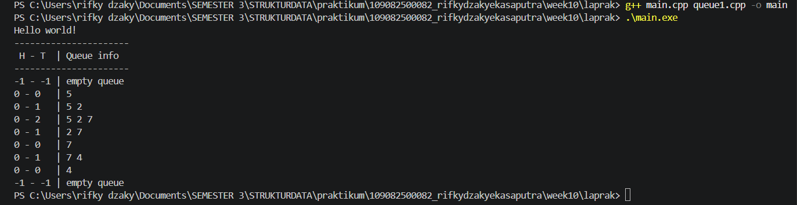
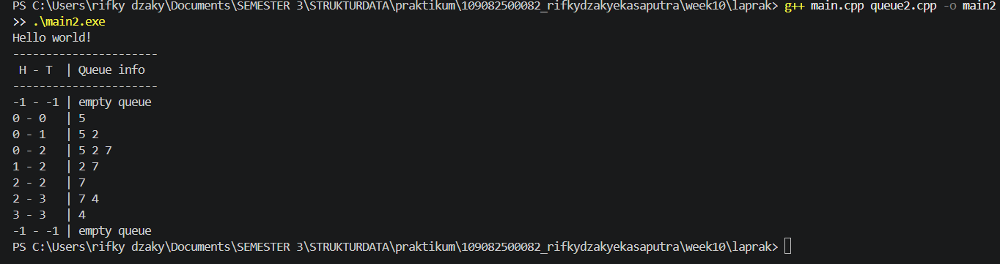
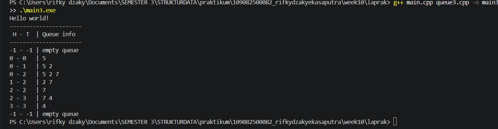

# <h1 align="center">Laporan Praktikum Modul 8 - QUEUE</h1>
<p align="center">Rifky Dzaky Eka Saputra - 109082500082</p>

## Dasar Teori
Queue atau antrean adalah struktur data linear yang menerapkan prinsip FIFO (First In First Out), yaitu elemen yang pertama dimasukkan akan menjadi elemen pertama yang dikeluarkan[1]. Penambahan elemen dilakukan di satu ujung yang disebut `tail` (belakang), sedangkan pengambilan elemen dilakukan di ujung lainnya yang disebut `head` (depan)[1]. Queue dapat direpresentasikan dengan array statis, yang kapasitasnya tetap sehingga queue bisa penuh, atau dengan linked list, yang ukurannya dinamis karena node dialokasikan saat dibutuhkan[1]. Implementasinya dalam C++ memanfaatkan `struct`, percabangan, dan perulangan yang diterjemahkan dari notasi algoritma[2].

### A. ADT Queue<br/>
ADT queue memisahkan deklarasi tipe dan prototipe prosedur di file header (`.h`) dari implementasinya di file `.cpp`. Pada praktikum ini ada dua representasi yang dipakai, yaitu linked list dan array.
#### 1. Queue dengan linked list — struct `elmQ` berisi `info` dan pointer `next`, sedangkan struct `queue` menyimpan pointer `head` dan `tail`. Queue kosong jika `head` bernilai `Nil`
#### 2. Queue dengan array — struct `Queue` berisi array `info` berkapasitas 5 elemen serta variabel `head` dan `tail`. Queue kosong jika `head` dan `tail` bernilai -1
#### 3. Pembuatan dan pengecekan queue — `createQueue()` membuat queue kosong, `isEmptyQueue()` mengecek apakah queue kosong, dan `isFullQueue()` mengecek apakah queue penuh (hanya pada array)[1]

### B. Operasi pada Queue<br/>
Operasi utama pada queue adalah `enqueue` untuk menambah elemen di `tail` dan `dequeue` untuk mengambil elemen dari `head`[1], dengan pengecekan agar tidak terjadi queue penuh saat `enqueue` maupun queue kosong saat `dequeue`.
#### 1. Enqueue — menambah elemen baru di belakang queue lalu menggeser `tail`
#### 2. Dequeue — mengambil elemen di `head`. Pada array ada dua cara: elemen digeser ke depan sehingga `head` selalu di indeks 0 (head diam), atau `head` cukup dimajukan (head bergerak)
#### 3. Circular queue — `head` dan `tail` bergerak melingkar memakai operasi modulo `(indeks + 1) % 5`, sehingga slot kosong di depan array bisa dipakai kembali dan queue tidak cepat penuh

## Guided 1

### 1. queue.h

```C++
#ifndef QUEUE_H_INCLUDE
#define QUEUE_H_INCLUDE

#include <iostream>
using namespace std;

#define Nil NULL

typedef bool boolean;
typedef int infotype;
typedef struct elmQ *address;

struct elmQ {
    infotype info;
    address next;
};

struct queue {
    address head, tail;
};

boolean isEmpty(queue Q);
void CreateQueue(queue &Q);
address alokasi(infotype X);
void dealokasi(address P);
address findElm(queue Q, infotype X);
boolean fFindElm(queue Q, address P);
void insert(queue &Q, address P);
void deleteQueue(queue &Q, address &P);
void printInfo(queue Q);
int nbList(queue Q);
void delAll(queue &Q);

#endif
```
File header ini mendefinisikan ADT queue dengan representasi linked list. Struct elmQ adalah node yang berisi info bertipe infotype (int) dan pointer next, sedangkan struct queue berisi pointer head dan tail. Nil didefinisikan sebagai NULL. File ini juga mendeklarasikan prototipe operasi queue, yaitu isEmpty, CreateQueue, alokasi, dealokasi, findElm, fFindElm, insert, deleteQueue, printInfo, nbList, dan delAll.

### 2. queue.cpp

```C++
#include "queue.h"

boolean isEmpty(queue Q) {
    return (Q.head == Nil);
}

void CreateQueue(queue &Q) {
    Q.head = Nil;
    Q.tail = Nil;
}

address alokasi(infotype X) {
    address P = new (nothrow) elmQ;
    if (P != Nil) {
        P->info = X;
        P->next = Nil;
    }
    return P;
}

void dealokasi(address P) {
    delete P;
}

address findElm(queue Q, infotype X) {
    address P = Q.head;
    while (P != Nil) {
        if (P->info == X) {
            return P;
        }
        P = P->next;
    }
    return Nil;
}

boolean fFindElm(queue Q, address P) {
    address R = Q.head;
    while (R != Nil) {
        if (R == P) {
            return true;
        }
        R = R->next;
    }
    return false;
}

void insert(queue &Q, address P) {
    if (isEmpty(Q)) {
        Q.head = P;
        Q.tail = P;
    } else {
        (Q.tail)->next = P;
        Q.tail = P;
    }
}

void deleteQueue(queue &Q, address &P) {
    P = Q.head;
    if (Q.head == Q.tail) {
        Q.head = Nil;
        Q.tail = Nil;
    } else {
        Q.head = P->next;
    }
    P->next = Nil;
}

void printInfo(queue Q) {
    if (isEmpty(Q)) {
        cout << "Queue kosong" << endl;
    } else {
        address P = Q.head;
        while (P != Nil) {
            cout << P->info << " ";
            P = P->next;
        }
        cout << endl;
    }
}

int nbList(queue Q) {
    int jumlah = 0;
    address P = Q.head;
    while (P != Nil) {
        jumlah++;
        P = P->next;
    }
    return jumlah;
}

void delAll(queue &Q) {
    address P;
    while (!isEmpty(Q)) {
        deleteQueue(Q, P);
        dealokasi(P);
    }
}
```
File ini mengimplementasikan seluruh operasi queue. CreateQueue() mengisi head dan tail dengan Nil, dan isEmpty() bernilai true jika head bernilai Nil. alokasi() membuat node baru dengan new (nothrow) lalu mengisi info dan mengosongkan next, sedangkan dealokasi() membebaskan node dengan delete. Prosedur insert() menambah node di belakang queue: jika queue kosong, head dan tail menunjuk node baru, jika tidak next milik tail diarahkan ke node baru lalu tail dipindah. Prosedur deleteQueue() menyimpan node di head ke P, lalu jika head sama dengan tail (hanya satu elemen) keduanya di-set Nil, jika tidak head dimajukan ke P->next. Fungsi findElm() menelusuri queue dari head untuk mencari node dengan info tertentu dan mengembalikan Nil jika tidak ketemu, sedangkan fFindElm() mengecek apakah sebuah alamat node ada di dalam queue. Fungsi nbList() menghitung jumlah node dengan traversal, dan delAll() memanggil deleteQueue() dan dealokasi() berulang sampai queue kosong.

### 3. main.cpp

```C++
#include <iostream>
#include "queue.h"
using namespace std;

int main() {
    queue Q;
    address P;

    CreateQueue(Q);
    cout << "isEmpty : " << isEmpty(Q) << endl;
    printInfo(Q);

    insert(Q, alokasi(5));
    insert(Q, alokasi(2));
    insert(Q, alokasi(7));
    cout << "Setelah insert 5, 2, 7" << endl;
    printInfo(Q);
    cout << "nbList  : " << nbList(Q) << endl;

    P = findElm(Q, 2);
    if (P != Nil) {
        cout << "findElm(2) ketemu, info : " << P->info << endl;
        cout << "fFindElm : " << fFindElm(Q, P) << endl;
    }
    if (findElm(Q, 9) == Nil) {
        cout << "findElm(9) tidak ketemu" << endl;
    }

    deleteQueue(Q, P);
    cout << "Setelah delete, elemen yang dihapus : " << P->info << endl;
    dealokasi(P);
    printInfo(Q);

    delAll(Q);
    cout << "Setelah delAll" << endl;
    printInfo(Q);
    cout << "isEmpty : " << isEmpty(Q) << endl;

    return 0;
}
```
Program utama membuat queue kosong lalu mengecek isEmpty (hasilnya 1) dan menampilkan "Queue kosong". Setelah itu program melakukan insert untuk angka 5, 2, dan 7 sehingga isi queue menjadi 5 2 7 dengan nbList bernilai 3. Program lalu mencari angka 2 dengan findElm yang ketemu (dan fFindElm bernilai 1) serta angka 9 yang tidak ketemu. Berikutnya deleteQueue mengambil elemen paling depan, yaitu 5, dan node-nya dibebaskan dengan dealokasi, sehingga sisa queue adalah 2 7. Terakhir delAll menghapus seluruh elemen sehingga queue kosong kembali dan isEmpty bernilai 1.

## Guided 
### 1. queue.h
```c++
#ifndef QUEUE_H
#define QUEUE_H

#include <iostream>
using namespace std;

const int MAKSIMAL = 5;

struct queue {
    string nama[MAKSIMAL];
    int head;
    int tail;
};

bool isFull(queue Q);
bool isEmpty(queue Q);
void CreateQueue(queue &Q);
void enQueue(queue &Q, string nama);
void deQueue(queue &Q);
void viewQueue(queue Q);

#endif
```
File header ini mendefinisikan ADT queue dengan representasi array. Konstanta MAKSIMAL bernilai 5 sebagai kapasitas queue, dan struct queue berisi array nama bertipe string beserta head dan tail. File ini mendeklarasikan prototipe isFull, isEmpty, CreateQueue, enQueue, deQueue, dan viewQueue.

### 2. queue.cpp
```c++
#include "queue.h"
#include <iostream>

using namespace std;

// NOTE : 
// Implementasi 1 = head diam, tail bergerak (Queue Linear Statis, kerana head nya tetap diam)
// Implementasi 2 = head bergerak, tail bergerak (Queue Linear Dinamis, karena head & tail nya sama-sama bergerak)
// Implementasi 3 = head dan tail berputar (Queue Circular, karena jika udh mentok tapi masih ada space, diputar sehingga tail bisa ada didepan head)

bool isEmpty(queue Q){
    if(Q.head == -1 && Q.tail == -1){
        return true;
    } else {
        return false;
    }
}

//isFull implmenetasi 1 & 2
bool isFull(queue Q){
    if(Q.tail == MAKSIMAL - 1){
        return true;
    } else {
        return false;
    }
}

// //isFull implementasi 3
// bool isFull(queue Q){
//     if((Q.tail + 1) % MAKSIMAL == Q.head){
//         return true;
//     } else {
//         return false;
//     }
// }

void CreateQueue(queue &Q){ //terbentuk queue dengan head = -1 dan tail = -1 
    Q.head = -1;
    Q.tail = -1;
}
 

//enqueue implementasi 1 & 2
void enQueue(queue &Q, string nama){
    if(isFull(Q) == true){
        cout << "Queue sudah penuh!" << endl;
    } else {
        if(isEmpty(Q) == true){
            Q.head = Q.tail = 0;
        } else {
            Q.tail++;
        }
        Q.nama[Q.tail] = nama;
        cout << "nama " << nama << " berhasil ditambahkan kedalam queue!" << endl;
    }
}

// //enQueue implementasi 3
// void enQueue(queue &Q, string nama){
//     if(isFull(Q) == true){
//         cout << "Queue sudah penuh!" << endl;
//     } else {
//         if(isEmpty(Q) == true){
//             Q.head = Q.tail = 0;
//         } else {
//             Q.tail = (Q.tail + 1) % MAKSIMAL; // bergerak melingkar
//         }
//         Q.nama[Q.tail] = nama;
//         cout << "nama " << nama << " berhasil ditambahkan kedalam queue!" << endl;
//     }
// }

//dequeue implementasi 1
void deQueue(queue &Q){
    if(isEmpty(Q) == true){
        cout << "Queue kosong!" << endl;
    } else {
        cout << "Mengahapus data " << Q.nama[Q.head] << "..." << endl;
        for(int i = 0; i < Q.tail; i++){
            Q.nama[i] =  Q.nama[i+1];
        }
        Q.tail--;
        if(Q.tail < 0){ //kalo semua isi queue nya udh dikelaurin, set head & tail ke -1
            Q.head = -1;
            Q.tail = -1;
        }
    }
}

// //dequeue implementasi 2
// void deQueue(queue &Q){
//     if(isEmpty(Q) == true){
//         cout << "Queue kosong!" << endl;
//     } else {
//         cout << "Mengahapus data " << Q.nama[Q.head] << "..." << endl;
//         Q.head++;
//         if(Q.head > Q.tail){ //kalo elemennya udh abis (head akan lebih 1 dari tail), maka reset ulang head & tail ke -1
//             Q.head = -1;
//             Q.tail = -1;
//         }
//     }
// }

// //deQueue implementasi 3
// void deQueue(queue &Q){
//     if(isEmpty(Q) == true){
//         cout << "Queue kosong!" << endl;
//     } else {
//         cout << "Mengahapus data " << Q.nama[Q.head] << "..." << endl;
//         if(Q.head == Q.tail){ //kalo elemennya tinggal 1, langsungkan saja head & tail nya reset ke -1
//             Q.head = -1;
//             Q.tail = -1;
//         } else {
//             Q.head = (Q.head + 1) % MAKSIMAL; // bergerak melingkar
//         }
//     }
// }

//viewQueue implementasi 1 & 2
void viewQueue(queue Q){
    if(isEmpty(Q) == true){
        cout << "Queue kosong!" << endl;
    } else {
        for(int i = Q.head; i <= Q.tail; i++){
            cout << i -  Q.head + 1 << ". " << Q.nama[i] << endl;
        }
    }
    cout << endl;
}

// //viewQueue implementasi 3
// void viewQueue(queue Q){
//     if(isEmpty(Q) == true){
//         cout << "Queue kosong!" << endl;
//     } else {
//         int i = Q.head;
//         int count = 1;
//         while(true){
//             cout << count << ". " << Q.nama[i] << endl;
//             if(i == Q.tail){
//                 break;
//             }
//             i = (i + 1) % MAKSIMAL;
//             count++;
//         }   
//     }
// }
```
File ini berisi tiga implementasi queue array, dan yang aktif adalah implementasi 1 sedangkan implementasi 2 dan 3 dikomentari. CreateQueue() mengisi head dan tail dengan -1, dan isEmpty() bernilai true jika keduanya -1. Pada implementasi 1 (head diam, tail bergerak), isFull() bernilai true jika tail sudah di indeks MAKSIMAL - 1. enQueue() mengisi head dan tail dengan 0 jika queue kosong, atau menaikkan tail jika tidak, lalu menyimpan nama di indeks tail. deQueue() menggeser semua elemen satu indeks ke kiri lalu menurunkan tail, sehingga head selalu di indeks 0, dan jika tail menjadi negatif maka head dan tail di-reset ke -1. Pada implementasi 2 (head dan tail bergerak), deQueue() cukup menaikkan head tanpa menggeser elemen, dan queue di-reset jika head melewati tail. Pada implementasi 3 (circular), isFull() memakai (tail + 1) % MAKSIMAL == head, dan head serta tail digerakkan dengan operasi modulo supaya berputar. viewQueue() pada circular memakai loop while(true) yang berhenti saat indeks mencapai tail, karena posisi head bisa berada di belakang tail.

### 3. main.cpp
```c++
#include "queue.h"
#include <iostream>

using namespace std;

int main(){
    queue Q;

    CreateQueue(Q);
    enQueue(Q, "Dimas");
    enQueue(Q, "Arvin");
    enQueue(Q, "Rizal");
    enQueue(Q, "Hafizh");
    enQueue(Q, "Fathur");
    enQueue(Q, "Daffa");
    cout << endl;

    cout << "--- Isi Queue Setelah enQueue ---" << endl;
    viewQueue(Q);
    cout << endl;

    deQueue(Q);
    deQueue(Q);
    deQueue(Q);
    deQueue(Q);
    // deQueue(Q);
    // deQueue(Q);
    cout << endl;

    cout << "--- Isi Queue Setelah deQueue ---" << endl;
    viewQueue(Q);

    return 0;
}
```
Program utama membuat queue kosong lalu melakukan enQueue untuk enam nama. Karena kapasitas hanya 5, nama keenam (Daffa) ditolak dengan pesan "Queue sudah penuh!", sehingga isi queue adalah Dimas, Arvin, Rizal, Hafizh, dan Fathur. Program kemudian memanggil deQueue sebanyak empat kali yang berturut-turut menghapus Dimas, Arvin, Rizal, dan Hafizh sesuai prinsip FIFO. Pada viewQueue terakhir, queue hanya berisi satu elemen, yaitu Fathur.

## Unguided 

### 1. (Buatlah ADT Queue menggunakan ARRAY sebagai berikut di dalam file “queue.h”:)

### queue.h
```C++
#ifndef QUEUE_H
#define QUEUE_H

#include <iostream>
using namespace std;

typedef int infotype;

struct Queue {
    infotype info[5];
    int head, tail;
};

void createQueue(Queue &Q);
bool isEmptyQueue(Queue Q);
bool isFullQueue(Queue Q);
void enqueue(Queue &Q, infotype x);
infotype dequeue(Queue &Q);
void printInfo(Queue Q);

#endif
```
File header ini mendefinisikan ADT queue dengan array yang dipakai bersama oleh ketiga soal. infotype adalah alias dari int, dan struct Queue berisi array info berkapasitas 5 elemen serta variabel head dan tail. File ini mendeklarasikan prototipe createQueue, isEmptyQueue, isFullQueue, enqueue, dequeue, dan printInfo.

### queue1.cpp
```c++
#include "queue.h"

void createQueue(Queue &Q) {
    Q.head = -1;
    Q.tail = -1;
}

bool isEmptyQueue(Queue Q) {
    return Q.head == -1 && Q.tail == -1;
}

bool isFullQueue(Queue Q) {
    return Q.tail == 4;
}

void enqueue(Queue &Q, infotype x) {
    if (isFullQueue(Q)) {
        cout << "Queue penuh!" << endl;
    } else if (isEmptyQueue(Q)) {
        Q.head = 0;
        Q.tail = 0;
        Q.info[Q.tail] = x;
    } else {
        Q.tail++;
        Q.info[Q.tail] = x;
    }
}

infotype dequeue(Queue &Q) {
    if (isEmptyQueue(Q)) {
        cout << "Queue kosong!" << endl;
        return -1;
    }
    infotype x = Q.info[Q.head];
    for (int i = Q.head; i < Q.tail; i++) {
        Q.info[i] = Q.info[i + 1];
    }
    Q.tail--;
    if (Q.tail < 0) {
        Q.head = -1;
        Q.tail = -1;
    }
    return x;
}

void printInfo(Queue Q) {
    cout << Q.head << " - " << Q.tail << "\t| ";
    if (isEmptyQueue(Q)) {
        cout << "empty queue" << endl;
    } else {
        for (int i = Q.head; i <= Q.tail; i++) {
            cout << Q.info[i] << " ";
        }
        cout << endl;
    }
}
```
File ini mengimplementasikan queue array dengan head diam dan tail bergerak. createQueue() mengisi head dan tail dengan -1, dan isEmptyQueue() bernilai true jika keduanya -1. isFullQueue() bernilai true jika tail sudah di indeks 4. Prosedur enqueue() punya tiga kondisi: jika penuh menampilkan pesan "Queue penuh!", jika kosong head dan tail diisi 0 lalu data disimpan, dan jika tidak tail dinaikkan lalu data disimpan. Fungsi dequeue() menyimpan elemen di head ke variabel x, lalu menggeser semua elemen satu indeks ke kiri dan menurunkan tail, sehingga head tetap di indeks 0. Jika tail menjadi negatif, head dan tail di-reset ke -1, dan nilai x dikembalikan. Prosedur printInfo() menampilkan nilai head - tail lalu isi queue dari head sampai tail, atau tulisan "empty queue" jika kosong.

### main.cpp
```c++
#include "queue.h"

int main() {
    cout << "Hello world!" << endl;
    Queue Q;
    createQueue(Q);

    cout << "----------------------" << endl;
    cout << " H - T \t| Queue info" << endl;
    cout << "----------------------" << endl;
    printInfo(Q);
    enqueue(Q, 5); printInfo(Q);
    enqueue(Q, 2); printInfo(Q);
    enqueue(Q, 7); printInfo(Q);
    dequeue(Q);    printInfo(Q);
    dequeue(Q);    printInfo(Q);
    enqueue(Q, 4); printInfo(Q);
    dequeue(Q);    printInfo(Q);
    dequeue(Q);    printInfo(Q);

    return 0;
}
```
Program utama membuat queue kosong lalu menjalankan urutan enqueue dan dequeue sambil menampilkan kondisi queue setiap langkah dengan printInfo(). Program memasukkan 5, 2, dan 7, kemudian melakukan dequeue dua kali sehingga tersisa 7, lalu enqueue 4, dan terakhir dequeue dua kali sampai queue kosong. Program utama ini dipakai sama untuk ketiga soal.

### Output Unguided 1 :

##### Output 1


### 2. (Buatlah implementasi ADT Queue pada file “queue.cpp” dengan menerapkan mekanisme queue  Alternatif 2 (head bergerak, tail bergerak) )

### queue2.cpp
```C++
#include "queue.h"

void createQueue(Queue &Q) {
    Q.head = -1;
    Q.tail = -1;
}

bool isEmptyQueue(Queue Q) {
    return Q.head == -1 && Q.tail == -1;
}

bool isFullQueue(Queue Q) {
    return Q.tail == 4;
}

void enqueue(Queue &Q, infotype x) {
    if (isFullQueue(Q)) {
        cout << "Queue penuh!" << endl;
    } else if (isEmptyQueue(Q)) {
        Q.head = 0;
        Q.tail = 0;
        Q.info[Q.tail] = x;
    } else {
        Q.tail++;
        Q.info[Q.tail] = x;
    }
}

infotype dequeue(Queue &Q) {
    if (isEmptyQueue(Q)) {
        cout << "Queue kosong!" << endl;
        return -1;
    }
    infotype x = Q.info[Q.head];
    Q.head++;
    if (Q.head > Q.tail) {
        Q.head = -1;
        Q.tail = -1;
    }
    return x;
}

void printInfo(Queue Q) {
    cout << Q.head << " - " << Q.tail << "\t| ";
    if (isEmptyQueue(Q)) {
        cout << "empty queue" << endl;
    } else {
        for (int i = Q.head; i <= Q.tail; i++) {
            cout << Q.info[i] << " ";
        }
        cout << endl;
    }
}
```
File ini hampir sama dengan queue1.cpp, perbedaannya ada di fungsi dequeue(). Pada implementasi ini elemen tidak digeser, melainkan head cukup dinaikkan satu setelah elemen di head disimpan ke variabel x. Jika head menjadi lebih besar dari tail, berarti semua elemen sudah keluar sehingga head dan tail di-reset ke -1. Dengan cara ini dequeue lebih cepat karena tidak ada perulangan untuk menggeser, tetapi indeks di depan yang sudah dikosongkan tidak bisa dipakai lagi.

### Output Unguided 2 :

##### Output 1


### 3. (Buatlah implementasi ADT Queue pada file “queue.cpp” dengan menerapkan mekanisme queue  Alternatif 3 (head dan tail berputar) )

### queue3.cpp
```C++
#include "queue.h"

void createQueue(Queue &Q) {
    Q.head = -1;
    Q.tail = -1;
}

bool isEmptyQueue(Queue Q) {
    return Q.head == -1 && Q.tail == -1;
}

bool isFullQueue(Queue Q) {
    return (Q.tail + 1) % 5 == Q.head;
}

void enqueue(Queue &Q, infotype x) {
    if (isFullQueue(Q)) {
        cout << "Queue penuh!" << endl;
    } else if (isEmptyQueue(Q)) {
        Q.head = 0;
        Q.tail = 0;
        Q.info[Q.tail] = x;
    } else {
        Q.tail = (Q.tail + 1) % 5;
        Q.info[Q.tail] = x;
    }
}

infotype dequeue(Queue &Q) {
    if (isEmptyQueue(Q)) {
        cout << "Queue kosong!" << endl;
        return -1;
    }
    infotype x = Q.info[Q.head];
    if (Q.head == Q.tail) {
        Q.head = -1;
        Q.tail = -1;
    } else {
        Q.head = (Q.head + 1) % 5;
    }
    return x;
}

void printInfo(Queue Q) {
    cout << Q.head << " - " << Q.tail << "\t| ";
    if (isEmptyQueue(Q)) {
        cout << "empty queue" << endl;
    } else {
        int i = Q.head;
        while (true) {
            cout << Q.info[i] << " ";
            if (i == Q.tail) break;
            i = (i + 1) % 5;
        }
        cout << endl;
    }
}
```
File ini mengimplementasikan queue array secara melingkar. isFullQueue() memakai (tail + 1) % 5 == head, artinya queue penuh jika posisi setelah tail adalah head. Pada enqueue(), tail digerakkan dengan tail = (tail + 1) % 5, sehingga setelah indeks 4 tail kembali ke indeks 0 selama slot di depan kosong. Pada dequeue(), head digerakkan dengan head = (head + 1) % 5, dan jika head sama dengan tail (tinggal satu elemen) maka head dan tail di-reset ke -1. Prosedur printInfo() memakai perulangan while(true) yang berhenti saat indeks mencapai tail, karena pada circular queue head bisa berada di indeks yang lebih besar dari tail.

### Output Unguided 3 :

##### Output 1


## Kesimpulan
Berdasarkan praktikum yang telah dilakukan, dapat disimpulkan bahwa queue merupakan struktur data linear yang bekerja dengan prinsip FIFO, di mana penambahan elemen dilakukan di `tail` dan penghapusan elemen dilakukan di `head`. Queue dapat diimplementasikan dengan linked list yang ukurannya dinamis, atau dengan array yang kapasitasnya tetap. Pada queue array, pendekatan head diam membuat `dequeue` harus menggeser elemen sehingga lebih lambat, sedangkan pendekatan head bergerak membuat `dequeue` lebih cepat tetapi ruang kosong di depan tidak bisa dipakai kembali. Circular queue mengatasi masalah tersebut dengan operasi modulo sehingga ruang array dapat dimanfaatkan secara efisien, dengan konsekuensi kondisi penuh dan proses penelusuran menjadi lebih rumit. Pada urutan operasi di `main.cpp`, ketiga mekanisme menghasilkan isi queue yang sama dan berakhir dengan queue kosong, dengan perbedaan pada posisi `head` dan `tail`, sedangkan keunggulan circular queue belum terlihat karena `tail` tidak pernah mencapai indeks terakhir

## Referensi
[1] Universitas Komputer Indonesia. (n.d.). Bab IX - Queue. Repository UNIKOM. Diakses pada 23 November 2026 melalui [https://repository.unikom.ac.id/39337/1/Bab%20IX%20-%20Queue.pdf](https://repository.unikom.ac.id/39337/1/Bab%20IX%20-%20Queue.pdf)  
[2] Indahyanti, U., Rahmawati, Y. (2020). Buku Ajar Algoritma dan Pemrograman dalam Bahasa C++. Sidoarjo: Umsida Press. Diakses pada 23 November 2026 melalui [https://doi.org/10.21070/2020/978-623-6833-67-4](https://doi.org/10.21070/2020/978-623-6833-67-4)