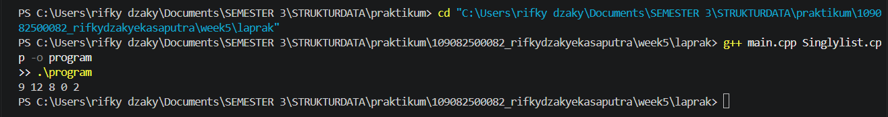
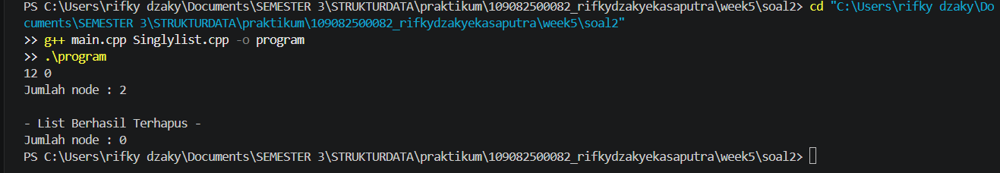

# <h1 align="center">Laporan Praktikum Modul 4 - SINGLY LINKED LIST (Bagian Pertama)</h1>
<p align="center">rifky dzaky eka saputra - 109082500082</p>

## Dasar Teori
Linked list atau yang disebut juga senarai berantai adalah salah satu bentuk struktur data yang berisi kumpulan data yang tersusun secara sekuensial, saling bersambungan, dinamis, dan terbatas. Linked list terdiri dari sejumlah node atau simpul yang dihubungkan secara linier dengan bantuan pointer. Linked list fleksibel untuk mengolah data dinamis karena data dapat ditambah dan dihapus tanpa memindahkan elemen lain[1].

### A. . Singly Linked List<br/>
Singly linked list adalah linked list yang setiap node-nya hanya memiliki satu pointer ke node berikutnya, sehingga penelusurannya hanya satu arah dari awal hingga akhir list[1].
#### 1. Node
Satu node terdiri dari bagian data dan pointer next yang menyimpan alamat node berikutnya[1].
#### 2. First dan Nil
Pointer first menunjuk node pertama. List kosong jika first bernilai Nil, dan node terakhir ditandai dengan next bernilai Nil.
#### 3. Alokasi dan Dealokasi
Node dialokasikan saat program berjalan sesuai kebutuhan (memori dinamis)[2], dengan new untuk membuat node dan delete untuk melepasnya.

### B. Operasi Dasar<br/>
Operasi dasar linked list meliputi penambahan node, penghapusan node, dan penampilan isi list[1].
#### 1. Insert
Menambah node di awal (insertFirst), setelah node tertentu (insertAfter), atau di akhir list (insertLast).
#### 2. Delete
Menghapus node pertama (delFirst), terakhir (delLast), atau setelah node tertentu (delAfter), dengan menyambungkan kembali pointer agar rantai tidak terputus.
#### 3. Traversal
Menelusuri list dari first sampai Nil untuk menampilkan isi list dan menghitung jumlah node[1].

## Guided 

### 1. list.h

```C++
//hear guard digunakan untuk mencegah file header yg sama
//di-include lebih dari sekali dalam 1 program
#ifndef LIST_H
#define LIST_H
#define Nil NULL

#include<iostream>
using namespace std;

//deklarasi isi data struct mahasiswa
struct mahasiswa {
    string nama;
    string nim;
    int umur;
};

typedef mahasiswa dataMahasiswa; //memberikan nama alias dataMahasiswa untuk struct mahasiswa

typedef struct node *address; //mendefinisikan alias address sebagai pointer ke struct node

struct node { //node untuk isi dari linked listnya, isis setiap node adalah data & pointer next
    dataMahasiswa isidata;
    address next;
};

struct linkedList { //ini linked listnya
    address first;
};

//semua function & prosedure yang akan dipakai
bool isEmpty(linkedList list);
void createList(linkedList &list);
address alokasi(string nama, string nim, int umur);
void dealokasi(address &node);
void printList(linkedList list);
void insertFirst(linkedList &list, address nodeBaru);
void insertAfter(linkedList &list, address nodeBaru, address Prev);
void insertLast(linkedList &list, address nodeBaru);

void delFirst(linkedList &list);
void delLast(linkedList &list);
void delAfter(linkedList &list, address nodeHapus, address nodePrev);
int nbList(linkedList list);
void deleteList(linkedList &list);

#endif
```
list.h itu file header yang isinya “daftar belanjaan” buat linked list data mahasiswa. Di situ ada header guard biar file nggak ke-include dua kali, Nil sebagai pengganti NULL, struct mahasiswa buat nyimpen nama, NIM, dan umur, terus node yang isinya data mahasiswa plus pointer next ke node berikutnya. Ada juga linkedList yang cuma nyimpen first (node paling depan). Sisanya cuma deklarasi fungsi buat insert, delete, print, dan hitung node, sedangkan isi fungsinya ditulis di list.cpp

### 2. list.cpp

```C++
#include "list.h"

//function untuk mengecek apakah list kosong
bool isEmpty(linkedList List) {
    return List.first == Nil;
}

//prosedur untuk membuat list kosong
void createList(linkedList &List) {
    List.first = Nil;
}

//function untuk mengalokasikan node baru
address alokasi(string nama, string nim, int umur) {
    address nodeBaru = new node;
    nodeBaru->isidata.nama = nama;
    nodeBaru->isidata.nim = nim;
    nodeBaru->isidata.umur = umur;
    nodeBaru->next = Nil;
    return nodeBaru;
}

//prosedur untuk dealokasi node
void dealokasi(address &node) {
    delete node;
    node = Nil;
}

//prosedur untuk menambahkan node di awal list
void insertFirst(linkedList &List, address nodeBaru) {
    /* I.S. sembarang, nodeBaru sudah dialokasikan
       F.S. menempatkan elemen nodeBaru pada awal list */
    nodeBaru->next = List.first;
    List.first = nodeBaru;
}

void insertAfter(linkedList &List, address nodeBaru, address Prev) {
    /* I.S. sembarang, nodeBaru dan Prev alamat salah satu elemen list (node)
       F.S. menempatkan elemen (node) sesudah elemen node Prev */
    if (Prev != Nil) {
        nodeBaru->next = Prev->next;
        Prev->next = nodeBaru;
    } else {
        cout << "Node sebelumnya tidak valid!" << endl;
    }
}

void insertLast(linkedList &List, address nodeBaru) {
    /* I.S. sembarang, nodeBaru sudah dialokasikan
       F.S. menempatkan elemen nodeBaru pada akhir list */
    if (isEmpty(List)) {
        List.first = nodeBaru;
    } else {
        address nodeBantu = List.first;
        while (nodeBantu->next != Nil) {
            nodeBantu = nodeBantu->next;
        }
        nodeBantu->next = nodeBaru;
    }
}

//prosedur-prosedur untuk delete / menghapus node yang ada didalam list
void delFirst(linkedList &List){
    /* I.S. list tidak kosong
       F.S. node pertama di list terhapus*/
    address nodeHapus;
    if (isEmpty(List) == false) {
        nodeHapus = List.first;
        List.first = List.first->next;
        nodeHapus->next = Nil;
        dealokasi(nodeHapus);
    } else {
        cout << "List kosong!" << endl;
    }
}

void delLast(linkedList &List){
    /* I.S. list tidak kosong
    F.S. node terakhir di list terhapus */
    address nodeHapus, nodePrev;
    if(isEmpty(List) == false){
        nodeHapus = List.first;
        if(nodeHapus->next == Nil){
            List.first->next = Nil;
            dealokasi(nodeHapus);
        } else {
            while(nodeHapus->next != Nil){
                nodePrev = nodeHapus;
                nodeHapus = nodeHapus->next;
            }
            nodePrev->next = Nil;
            dealokasi(nodeHapus);
        }
    } else {
        cout << "list kosong" << endl;
    }
}

void delAfter(linkedList &List, address nodeHapus, address nodePrev){
    /* I.S. list tidak kosng, Prev alamat salah satu elemen list
    F.S. nodeBantu adalah alamat dari Prev->next, menghapus Prev->next dari list */
    if(isEmpty(List) == true){
        cout << "List kosong!" << endl;
    } else { //jika list tidak kosong
        if (nodePrev != Nil && nodePrev->next != Nil) {
            nodeHapus = nodePrev->next;
            nodePrev->next = nodeHapus->next;
            nodeHapus->next = Nil;
            dealokasi(nodeHapus);
        } else {
            cout << "Node sebelumnya (prev) tidak valid!" << endl;
        }
    }
}

//prosedur untuk menampilkan isi list
void printList(linkedList List) {
    /* I.S. list mungkin kosong
       F.S. jika list tidak kosong menampilkan semua info yang ada pada list */
    if (isEmpty(List)) {
        cout << "List kosong." << endl;
    } else {
        address nodeBantu = List.first;
        while (nodeBantu != Nil) {
            cout << "Nama : " << nodeBantu->isidata.nama << ", NIM : " << nodeBantu->isidata.nim << ", Usia : " << nodeBantu->isidata.umur << endl;
            nodeBantu = nodeBantu->next;
        }
    }
}

//function untuk menampilkan jumlah node didalam list
int nbList(linkedList List) {
    /* I.S. list sudah ada
       F.S. menampilkan jumlah node didalam list*/
    int count = 0;
    address nodeBantu = List.first;
    while (nodeBantu != Nil) {
        count++;
        nodeBantu = nodeBantu->next;
    }
    return count;
}

//prosedur untuk menghapus list (menghapus semua node didalam list)
void deleteList(linkedList &List){
    /* I.S. list sudah ada
       F.S. menghapus semua node didalam list*/
    address nodeBantu, nodeHapus;
    nodeBantu = List.first;
    while(nodeBantu != Nil){
        nodeHapus = nodeBantu;
        nodeBantu = nodeBantu->next;
        dealokasi(nodeHapus);
    }
    List.first = Nil;
    cout << "List sudah terhapus!" << endl;
}
```
list.cpp itu file isi (implementasi) dari semua fungsi yang tadi cuma dideklarasiin di list.h. Di awal dia nge-include list.h biar kenal sama struct dan nama fungsinya. isEmpty ngecek list kosong atau nggak (kalau first masih Nil), createList bikin list kosong, alokasi bikin node baru pakai new terus ngisi nama, NIM, umur, sedangkan dealokasi ngehapus node dari memori pakai delete. Buat nambah node ada insertFirst (taruh di depan), insertAfter (taruh setelah node tertentu), dan insertLast (taruh di paling belakang, jadi harus jalan dulu sampai node terakhir pakai while). Buat ngehapus ada delFirst (hapus node depan), delLast (hapus node belakang, nyari node sebelumnya dulu pakai nodePrev), delAfter (hapus node setelah node tertentu), dan deleteList yang muter dari awal sampai akhir buat ngehapus semua node. Terakhir, printList buat nampilin isi list satu-satu dan nbList buat ngitung jumlah node pakai counter.

### 3. main.cpp

```C++
#include "list.h"

#include<iostream>
using namespace std;

int main(){
    linkedList List;
    address nodeA, nodeB, nodeC, nodeD, nodeE = Nil;
    createList(List);

    dataMahasiswa mhs;

    nodeA = alokasi("Dhimas", "2311102151", 20);
    nodeB = alokasi("Arvin", "2211110014", 21);
    nodeC = alokasi("Rizal", "2311110029", 20);
    nodeD = alokasi("Satrio", "2211102173", 21);
    nodeE = alokasi("Joshua", "2311102133", 21);

    insertFirst(List, nodeA);
    insertLast(List, nodeB);
    insertAfter(List, nodeC, nodeA);
    insertAfter(List, nodeD, nodeC);
    insertLast(List, nodeE);

    cout << "--- ISI LIST SETELAH DILAKUKAN INSERT ---" << endl;
    printList(List);
    cout << "jumlah node : " << nbList(List) << endl;
    cout << endl;

    delFirst(List);
    delLast(List);
    delAfter(List, nodeD, nodeC);

    cout << "--- ISI LIST SETELAH DILAKUKAN DELETE ---" << endl;
    printList(List);
    cout << "jumlah node : " << nbList(List) << endl;
    cout << endl;

    deleteList(List);
    cout << "--- ISI LIST SETELAH DILAKUKAN HAPUS LIST ---" << endl;
    printList(List);
    cout << "jumlah node : " << nbList(List) << endl;
    cout << endl;

    return 0;
}
```
main.cpp ini program utamanya, tempat semua fungsi dari list.cpp dipanggil dan dijalanin. Di awal dia nge-include list.h, terus bikin list kosong pakai createList dan nyiapin lima node (Dhimas, Arvin, Rizal, Satrio, Joshua) lewat alokasi. Abis itu node-nodenya dimasukin ke list: Dhimas di depan pakai insertFirst, Arvin di belakang pakai insertLast, Rizal disisipin setelah Dhimas, Satrio disisipin setelah Rizal, dan Joshua di paling belakang, jadi urutannya Dhimas, Rizal, Satrio, Arvin, Joshua. Setelah itu isi list ditampilin pakai printList dan jumlah nodenya pakai nbList (hasilnya 5). Lanjut ke tahap hapus: delFirst ngehapus Dhimas, delLast ngehapus Joshua, dan delAfter ngehapus node setelah Rizal (yaitu Satrio), jadi sisa Rizal dan Arvin (2 node). Terakhir, deleteList ngehapus semua node, lalu printList nampilin “List kosong.” dan jumlah node jadi 0.

## Unguided 

### 1. (Buatlah ADT Singly Linked list sebagai berikut di dalam file “Singlylist.h”) 

### singlylist.h
```C++
#ifndef SINGLYLIST_H
#define SINGLYLIST_H

#include <iostream>
using namespace std;

#define Nil NULL

typedef int infotype;
typedef struct ElmList *address;

struct ElmList {
    infotype info;
    address next;
};

struct List {
    address First;
};

// soal 1
void createList(List &L);
address alokasi(infotype x);
void dealokasi(address &P);
void printInfo(List L);
void insertFirst(List &L, address P);

// soal 2
void deleteFirst(List &L);
void deleteLast(List &L);
void deleteAfter(List &L, address Prev);
int nbList(List L);
void deleteList(List &L);

#endif
```
### singlylist.cpp
```C++
#include "Singlylist.h"

void createList(List &L) {
    L.First = Nil;
}

address alokasi(infotype x) {
    address P = new ElmList;
    P->info = x;
    P->next = Nil;
    return P;
}

void dealokasi(address &P) {
    delete P;
    P = Nil;
}

void printInfo(List L) {
    address P = L.First;
    while (P != Nil) {
        cout << P->info << " ";
        P = P->next;
    }
    cout << endl;
}

void insertFirst(List &L, address P) {
    P->next = L.First;
    L.First = P;
}

void deleteFirst(List &L) {
    if (L.First != Nil) {
        address P = L.First;
        L.First = P->next;
        P->next = Nil;
        dealokasi(P);
    }
}

void deleteLast(List &L) {
    if (L.First != Nil) {
        if (L.First->next == Nil) {
            address P = L.First;
            L.First = Nil;
            dealokasi(P);
        } else {
            address Prev = L.First;
            while (Prev->next->next != Nil) {
                Prev = Prev->next;
            }
            address P = Prev->next;
            Prev->next = Nil;
            dealokasi(P);
        }
    }
}

void deleteAfter(List &L, address Prev) {
    if (L.First != Nil && Prev != Nil && Prev->next != Nil) {
        address P = Prev->next;
        Prev->next = P->next;
        P->next = Nil;
        dealokasi(P);
    }
}

int nbList(List L) {
    int count = 0;
    address P = L.First;
    while (P != Nil) {
        count++;
        P = P->next;
    }
    return count;
}

void deleteList(List &L) {
    while (L.First != Nil) {
        deleteFirst(L);
    }
    cout << "- List Berhasil Terhapus -" << endl;
}
```
### Output Unguided 1 :

##### Output 1


Singlylist.h itu file header yang isinya “daftar belanjaan”. Di situ didefinisiin infotype (alias int), address (pointer ke ElmList), struct ElmList yang isinya info (angkanya) dan next (penunjuk ke node berikutnya), serta struct List yang cuma nyimpen First (node paling depan). Di bawahnya ada deklarasi lima prosedur: createList, alokasi, dealokasi, printInfo, dan insertFirst. Header guard (#ifndef) dipakai biar file nggak ke-include dua kali, dan Nil dipakai sebagai pengganti NULL.

Singlylist.cpp itu isi dari kelima prosedur tadi. createList bikin list kosong dengan ngisi First pakai Nil. alokasi bikin node baru pakai new, ngisi info dengan angka yang dikasih, dan next diisi Nil. dealokasi ngehapus node dari memori pakai delete. insertFirst masukin node ke paling depan: next node baru diarahin ke First yang lama, terus First pindah ke node baru. printInfo muter dari First sampai Nil sambil nyetak tiap info.

main.cpp itu program utamanya. Di situ dibuat list kosong, terus lima node dialokasi dengan nilai 2, 0, 8, 12, 9 dan masing-masing dimasukin pakai insertFirst. Karena tiap node selalu masuk di depan, urutannya kebalik dari urutan masuknya, jadi list akhirnya 9 → 12 → 8 → 0 → 2. Terakhir printInfo nampilin hasilnya: 9 12 8 0 2

### 2. (Dari soal latihan pertama, lakukan penghapusan node 9 menggunakan deleteFirst(), node 2 menggunakan deleteLast(), dan node 8 menggunakan deleteAfter(). Kemudian tampilkan jumlah node yang tersimpan menggunakan nbList() dan lakukan penghapusan seluruh node menggunakan deleteList().)

### main.cpp 
```C++
#include "Singlylist.h"

int main() {
    List L;
    address P1, P2, P3, P4, P5 = Nil;
    createList(L);

    P1 = alokasi(2);
    insertFirst(L, P1);

    P2 = alokasi(0);
    insertFirst(L, P2);

    P3 = alokasi(8);
    insertFirst(L, P3);

    P4 = alokasi(12);
    insertFirst(L, P4);

    P5 = alokasi(9);
    insertFirst(L, P5);

    deleteFirst(L);      // hapus 9
    deleteLast(L);       // hapus 2
    deleteAfter(L, P4);  // hapus 8 (node setelah 12)

    printInfo(L);
    cout << "Jumlah node : " << nbList(L) << endl;
    cout << endl;

    deleteList(L);
    cout << "Jumlah node : " << nbList(L) << endl;

    return 0;
}
```
### Output Unguided 2 :

##### Output 1


Jawaban soal 2 itu lanjutan dari soal 1. List-nya tetap dibikin sama (9 → 12 → 8 → 0 → 2), terus node-nodenya dihapus satu per satu pakai prosedur baru yang ditambahin di Singlylist.h dan Singlylist.cpp. Di Singlylist.h ditambah lima deklarasi: deleteFirst, deleteLast, deleteAfter, nbList, dan deleteList, sedangkan struct dan prosedur dari soal 1 nggak berubah. Di Singlylist.cpp, deleteFirst ngehapus node paling depan dengan mindahin First ke node kedua, baru node lama di-dealokasi. deleteLast ngehapus node paling belakang: kalau node-nya cuma satu, First langsung dikosongin, tapi kalau lebih, dia jalan sampai node kedua dari belakang, terus next-nya diputus jadi Nil dan node terakhir di-dealokasi. deleteAfter ngehapus node yang ada setelah Prev dengan cara ngelompatin Prev->next ke node sesudahnya, baru node yang dilewati di-dealokasi. nbList ngitung jumlah node pakai counter sambil muter dari First sampai Nil, dan deleteList ngehapus semua node dengan manggil deleteFirst terus-terusan sampai list kosong, lalu nampilin “- List Berhasil Terhapus -”. Di main.cpp, list dibikin kayak soal 1, terus deleteFirst ngehapus 9 (sisa 12, 8, 0, 2), deleteLast ngehapus 2 (sisa 12, 8, 0), dan deleteAfter(L, P4) ngehapus 8 yang ada setelah node 12 (sisa 12 dan 0). Setelah itu printInfo nampilin 12 0 dan nbList nampilin jumlah node 2, lalu deleteList ngehapus semuanya sehingga jumlah node yang ditampilin lagi jadi 0.

## Kesimpulan
Dari praktikum Modul 4 ini dapat disimpulkan bahwa singly linked list adalah struktur data dinamis yang tersusun dari node-node yang dihubungkan oleh pointer next, dengan pointer first sebagai penanda node pertama dan Nil sebagai penanda akhir list. Pada bagian Guided, list diisi data mahasiswa (nama, NIM, dan umur), kemudian diuji dengan insertFirst, insertLast, dan insertAfter sehingga terbentuk urutan Dhimas, Rizal, Satrio, Arvin, Joshua dengan jumlah 5 node. Setelah delFirst, delLast, dan delAfter dijalankan, tersisa 2 node, yaitu Rizal dan Arvin, dan setelah deleteList jumlah node menjadi 0. Pada bagian Unguided soal 1, lima node bernilai 2, 0, 8, 12, dan 9 dimasukkan dengan insertFirst sehingga hasilnya 9 12 8 0 2. Ini menunjukkan bahwa penyisipan di awal list membuat urutan data menjadi kebalikan dari urutan pemasukannya. Pada soal 2, penghapusan node 9 dengan deleteFirst, node 2 dengan deleteLast, dan node 8 dengan deleteAfter menyisakan 12 0 dengan jumlah node 2, dan setelah deleteList jumlah node menjadi 0, sesuai dengan output yang diharapkan.

Praktikum ini juga menunjukkan bahwa pengelolaan memori dinamis harus dilakukan dengan teliti: node dialokasikan dengan new dan harus dilepas dengan delete melalui dealokasi, serta pointer di sekitar node yang dihapus harus disambungkan kembali lebih dulu agar rantai list tidak terputus. Selain itu, pemisahan program menjadi file header (.h), file implementasi (.cpp), dan program utama (main.cpp) membuat kode lebih terstruktur dan mudah dikelola. Saat kompilasi, file main.cpp dan file implementasi harus dikompilasi bersama karena fungsi main() hanya terdapat di main.cpp, sedangkan isi prosedurnya berada di file implementasi. Hasil praktikum ini sejalan dengan teori bahwa linked list cocok untuk data yang sering berubah karena penambahan dan penghapusan node cukup dilakukan dengan mengubah pointer, tetapi penelusurannya tetap harus berurutan dari node pertama[1][2].

## Referensi
[1] Mbejo, M. T., Nopa, L. A., Putri, J. S., & Risky, M. (2025). "Analisis Struktur Data Linked List Dalam Pengolahan Data Mahasiswa". Jurnal Sains Informatika Terapan, 4(2), 441-444. https://doi.org/10.62357/jsit.v4i2.591. 
<br>[2] Setiyawan, R. D., Hermawan, D., Abdillah, A. F., Mujayanah, A., & Vindua, R. (2024). "Penggunaan Struktur Data Stack dalam Pemrograman C++ dengan Pendekatan Array dan Linked List". JUTECH: Journal Education and Technology, 5(2), 484-498. https://doi.org/10.31932/jutech.v5i2.4263.
