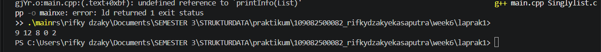
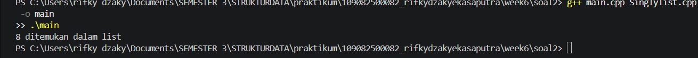
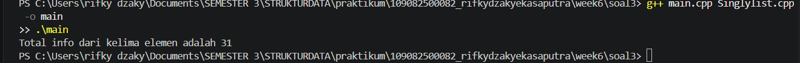

# <h1 align="center">Laporan Praktikum Modul 5 - SINGLY LINKED LIST (BAGIAN KEDUA)</h1>
<p align="center">Rifky dzaky eka saputra - 1090882500082</p>

## Dasar Teori
Singly linked list adalah struktur data dinamis yang terdiri dari sejumlah node yang dihubungkan secara linier menggunakan pointer, di mana setiap node hanya memiliki satu pointer next yang menunjuk ke node berikutnya[1]. Berbeda dengan array yang ukurannya tetap, linked list dapat bertambah dan berkurang ukurannya saat program berjalan karena memori tiap node dialokasikan secara dinamis[2]. Node terakhir menunjuk ke Nil (NULL) sebagai penanda akhir list, sedangkan pointer First pada struct List menjadi penunjuk node pertama.

### A. ADT Singly Linked List<br/>
ADT singly linked list memisahkan definisi struktur data dari implementasinya, yaitu deklarasi tipe dan prosedur ditulis di file header (.h) dan implementasinya di file .cpp. Dengan begitu, program utama cukup memanggil operasi yang tersedia tanpa perlu mengetahui detail penulisannya.
#### 1.  Tipe data 
infotype, address, ElmList, dan List
#### 2. Alokasi dan dealokasi
alokasi() membuat node dengan new, dealokasi() menghapusnya dengan delete
#### 3.  Insert dan print 
insertFirst() menambah node di awal list, printInfo() menampilkan isi list

### B. Penelusuran (Traversal) List<br/>
Penelusuran dilakukan dengan menggeser sebuah pointer bantu dari node pertama sampai bernilai Nil. Teknik ini dipakai untuk mencari elemen tertentu maupun menjumlahkan seluruh isi list.
#### 1. Pencarian elemen 
findElm() mengembalikan alamat node yang berisi nilai tertentu, atau Nil jika tidak ditemukan
#### 2.  Penjumlahan info 
menambahkan nilai info pada setiap node selama penelusuran
#### 3.  Penggunaan pointer bantu 
menggeser pointer ke next tanpa mengubah posisi First

### C. Update dan Searching pada Linked List<br/>
Update dilakukan dengan menelusuri list sampai node yang dituju, lalu mengganti isi datanya tanpa mengubah pointer next. Searching dilakukan dengan menelusuri list dari node pertama sambil membandingkan data tiap node dengan kriteria pencarian.
#### 1. Update
updateFirst, updateLast, dan updateAfter mengubah data node pada posisi tertentu
### 2. Searching berdasarkan data dan alamat
FindNodeByData dan FindNodeByAddress
### 3. Searching berdasarkan range 
FindNodeByRange menampilkan semua node yang nilainya berada dalam rentang tertentu

## Guided 

### 1.  listBuah.h

```C++
#ifndef LISTBUAH_H
#define LISTBUAH_H
#define Nil NULL

#include <iostream>
#include <string>
using namespace std;

struct buah{
    string nama;
    int jumlah; 
    float harga;
};

typedef buah dataBuah; 

typedef struct node *address; 

struct node{ 
    dataBuah isidata;
    address next;
};

struct linkedlist{ 
    address first;
};

bool isEmpty(linkedlist List);
void createList(linkedlist &List);
address alokasi(string nama, int jumlah, float harga);
void dealokasi(address &node);
void printList(linkedlist List);
void insertFirst(linkedlist &List, address nodeBaru);
void insertAfter(linkedlist &List, address nodeBaru, address nodePrev);
void insertLast(linkedlist &List, address nodeBaru);
void delFirst(linkedlist &List);
void delLast(linkedlist &List);
void delAfter(linkedlist &List, address nodeHapus, address nodePrev);
int nbList(linkedlist List);
void deleteList(linkedlist &List);

void updateFirst(linkedlist List);
void updateLast(linkedlist List);
void updateAfter(linkedlist List, address prev);

void FindNodeByData(linkedlist list, string data);
void FindNodeByAddress(linkedlist list, address node);
void FindNodeByRange(linkedlist list, float hargaAwal, float hargaAkhir);

#endif
```
File header ini mendefinisikan struct buah (nama, jumlah, harga) sebagai data tiap node, lalu struct node yang berisi isidata dan pointer next, serta struct linkedlist dengan pointer first sebagai penunjuk node pertama. typedef dipakai untuk membuat alias dataBuah dan address (pointer ke node). File ini juga mendeklarasikan prototipe semua operasi: insert, delete, update, dan searching, dan include guard (#ifndef) mencegah header terbaca lebih dari sekali.

### 2. listBuah.cpp

```C++
#include "listBuah.h"
#include <iostream>
using namespace std;

//fungsi untuk cek apakah list kosong atau tidak
bool isEmpty(linkedlist List) {
    if(List.first == Nil){
        return true; 
    } else {
        return false;
    }
}

//pembuatan linked list kosong
void createList(linkedlist &List) {
    List.first = Nil;
}

//pembuatan node baru dengan menerapkan manajemen memori
address alokasi(string nama, int jumlah, float harga) { 
    address nodeBaru = new node; 
    nodeBaru->isidata.nama = nama;
    nodeBaru->isidata.jumlah = jumlah; 
    nodeBaru->isidata.harga = harga;
    nodeBaru->next = Nil;
    return nodeBaru;
}

//penghapusan node dengan menerapkan manajemen memori
void dealokasi(address &node) {
    node->next = Nil;
    delete node;
}

//prosedur-prosedur untuk insert / menambahkan node baru kedalam list
void insertFirst(linkedlist &List, address nodeBaru) {
    nodeBaru->next = List.first; 
    List.first = nodeBaru;
}

void insertAfter(linkedlist &List, address nodeBaru, address Prev) {
    if (Prev != Nil) {
        nodeBaru->next = Prev->next;
        Prev->next = nodeBaru;
    } else {
        cout << "Node sebelumnya tidak valid!" << endl;
    }
}

void insertLast(linkedlist &List, address nodeBaru) {
    if (isEmpty(List)) {
        List.first = nodeBaru;
    } else {
        address nodeBantu = List.first;
        while (nodeBantu->next != Nil) {
            nodeBantu = nodeBantu->next;
        }
        nodeBantu->next = nodeBaru;
    }
}

//prosedur-prosedur untuk delete / menghapus node yang ada didalam list
void delFirst(linkedlist &List){
    address nodeHapus;
    if (isEmpty(List) == false) {
        nodeHapus = List.first;
        List.first = List.first->next;
        nodeHapus->next = Nil;
        dealokasi(nodeHapus);
        cout << "Node pertama berhasil terhapus!" << endl;
    } else {
        cout << "List kosong!" << endl;
    }
}

void delLast(linkedlist &List){
    address nodeHapus, nodePrev;
    if(isEmpty(List) == false){
        nodeHapus = List.first;
        if(nodeHapus->next == Nil){
            List.first = Nil;
            dealokasi(nodeHapus);
        } else { 
            while(nodeHapus->next != Nil){
                nodePrev = nodeHapus; 
                nodeHapus = nodeHapus->next;
            }
            nodePrev->next = Nil; 
            dealokasi(nodeHapus);
        }
        cout << "Node terakhir berhasil terhapus!" << endl;
    } else {
        cout << "list kosong" << endl;
    }
}

void delAfter(linkedlist &List, address nodeHapus, address nodePrev){
    if(isEmpty(List) == true){
        cout << "List kosong!" << endl;
    } else { //jika list tidak kosong
        if (nodePrev != Nil && nodePrev->next != Nil) { 
            nodeHapus = nodePrev->next;       
            nodePrev->next = nodeHapus->next;  
            nodeHapus->next = Nil;         
            dealokasi(nodeHapus);
            cout << "Node setelah node " << nodePrev->isidata.nama << " berhasil terhapus!" << endl;
        } else {
            cout << "Node sebelumnya (prev) tidak valid!" << endl;
        }
    }
}

//prosedur untuk menampilkan isi list
void printList(linkedlist List) {
    if (isEmpty(List)) {
        cout << "List kosong." << endl;
    } else {
        address nodeBantu = List.first;
        while (nodeBantu != Nil) { 
            cout << "Nama Buah : " << nodeBantu->isidata.nama << ", Jumlah : " << nodeBantu->isidata.jumlah << ", Harga : " << nodeBantu->isidata.harga << endl;
            nodeBantu = nodeBantu->next;
        }
    }
}

//function untuk menampilkan jumlah node didalam list
int nbList(linkedlist List) {
    int count = 0;
    address nodeBantu = List.first;
    while (nodeBantu != Nil) {
        count++;
        nodeBantu = nodeBantu->next; 
    }
    return count;
}

//prosedur untuk menghapus list (menghapus semua node didalam list)
void deleteList(linkedlist &List){
    address nodeBantu, nodeHapus;
    nodeBantu = List.first;
    while(nodeBantu != Nil){
        nodeHapus = nodeBantu;
        nodeBantu = nodeBantu->next;
        dealokasi(nodeHapus); 
    }
    List.first = Nil; 
    cout << "List berhasil terhapus!" << endl;
}

/*----- MATERI PERTEMUAN 5 - SINGLY LINKED LIST (BAGIAN KEDUA) - UPDATE -----*/
//prosedur-prosedur untuk melakukan update data node
void updateFirst(linkedlist List){
    if(isEmpty(List) == true){
        cout << "List kosong!" << endl;
    } else {
        cout << "Masukkan update data node pertama : " << endl;
        cout << "Nama buah : ";
        cin >> List.first->isidata.nama;
        cout << "Jumlah : ";
        cin >> List.first->isidata.jumlah;
        cout << "Harga : ";
        cin >> List.first->isidata.harga;
        cout << "Data Berhasil Diupdate!" << endl;
        cout << endl;
    }
}

void updateLast(linkedlist List){
    if (isEmpty(List) == true) {
        cout << "List Kosong!" << endl;
    } else {
        address nodeBantu = List.first;
        while (nodeBantu->next != Nil) {
            nodeBantu = nodeBantu->next;
        }
        cout << "masukkan update data node terakhir : " << endl;
        cout << "Nama buah : ";
        cin >> nodeBantu->isidata.nama;
        cout << "Jumlah : ";
        cin >> nodeBantu->isidata.jumlah;
        cout << "Harga : ";
        cin >> nodeBantu->isidata.harga;
        cout << "Data Berhasil Diupdate!" << endl;
        cout << endl;
    }
}

void updateAfter(linkedlist List, address nodePrev){
    if(isEmpty(List) == true){
        cout << "List kosong!" << endl;
    } else {
        if (nodePrev != Nil && nodePrev->next != Nil){
            address nodeBantu = nodePrev->next;
            cout << "masukkan update data node setelah node " << nodePrev->isidata.nama << " : " << endl;
            cout << "Nama buah : ";
            cin >> nodeBantu->isidata.nama;
            cout << "Jumlah : ";
            cin >> nodeBantu->isidata.jumlah;
            cout << "Harga : ";
            cin >> nodeBantu->isidata.harga;
            cout << "Data Berhasil Diupdate!" << endl;
            cout << endl;
        } else {
            cout << "Node sebelumnya (prev) tidak valid!" << endl;
        }
    }
}

/*----- MATERI PERTEMUAN 5 - SINGLY LINKED LIST (BAGIAN KEDUA) - SEARCHING -----*/
//prosedur-prosedur untuk searching data
//prosedur untuk mencari node berdasarkan data
void FindNodeByData(linkedlist list, string data){
    if(isEmpty(list) == true){
        cout << "List kosong!" << endl;
    } else {
        address nodeBantu = list.first;
        int posisi = 0;
        bool found = false;
        while(nodeBantu != Nil){
            posisi++;
            if(nodeBantu->isidata.nama == data){
                cout << "Data " << data << " ditemukan pada posisi ke-" << posisi << "!" << endl;
                cout << "Nama Buah : " << nodeBantu->isidata.nama << ", Jumlah : " << nodeBantu->isidata.jumlah << ", Harga : " << nodeBantu->isidata.harga << endl;
                found = true;
                break;
            }
            nodeBantu = nodeBantu->next;
        }
        if(found == false){
            cout << "Node dengan data " << data << " tidak ditemukan!" << endl;
        }
    }
    cout << endl;
}

//prosedur untuk mencari node berdasarkan alamat node
void FindNodeByAddress(linkedlist list, address node) {
    if(isEmpty(list) == true) {
        cout << "List kosong!" << endl;
    } else {
        address nodeBantu = list.first;
        int posisi = 0;
        bool found = false;
        while (nodeBantu != Nil) {
            posisi++;
            if(nodeBantu == node) {
                cout << "Node ditemukan pada posisi ke-" << posisi << "!" << endl;
                cout << "Alamat node : " << nodeBantu << endl;
                cout << "Nama Buah : " << nodeBantu->isidata.nama << ", Jumlah : " << nodeBantu->isidata.jumlah << ", Harga : " << nodeBantu->isidata.harga << endl;
                found = true;
                break;
            }
            nodeBantu = nodeBantu->next;
        }
        if(found == false) {
            cout << "Node dengan alamat " << node << " tidak ditemukan dalam list!" << endl;
        }
    }
    cout << endl;
}

//prosedur untuk mencari node berdasarkan range data (range harga)
void FindNodeByRange(linkedlist list, float hargaAwal, float hargaAkhir) {
    if(isEmpty(list) == true) {
        cout << "List kosong!" << endl;
    } else {
        address nodeBantu = list.first;
        int posisi = 0;
        bool found = false;
        cout << "--- Buah dalam range harga " << hargaAwal << " - " << hargaAkhir << " ---" << endl;
        cout << "-------------------------------------------" << endl;
        while (nodeBantu != Nil) {
            posisi++;
            float harga = nodeBantu->isidata.harga;
            if(harga >= hargaAwal && harga <= hargaAkhir) {
                cout << "Data ditemukan pada posisi ke-" << posisi << " :" << endl;
                cout << "Nama Buah : " << nodeBantu->isidata.nama << ", Jumlah : " << nodeBantu->isidata.jumlah << ", Harga : " << nodeBantu->isidata.harga << endl;
                cout << "-------------------------------------------" << endl;
                found = true;
            }
            nodeBantu = nodeBantu->next;
        }
        if(found == false) {
            cout << "Tidak ada data buah dalam range harga tersebut!" << endl;
            cout << "-------------------------------------------" << endl;
        }
    }
    cout << endl;
}
```
1.Dasar: createList() membuat list kosong, alokasi() membuat node baru dengan new, dealokasi() menghapus node dengan delete, dan isEmpty() mengecek apakah first bernilai Nil.
2.Insert dan delete: insertFirst, insertAfter, dan insertLast menyambungkan node baru ke posisi yang sesuai dengan mengatur pointer next. delFirst, delLast, dan delAfter melepas node dari rantai lalu mendealokasinya.
3.Update: updateFirst, updateLast, dan updateAfter mencari node di posisi tertentu, lalu mengganti isi datanya (nama, jumlah, harga) dengan input baru dari pengguna. Parameter List dikirim sebagai value, tapi data tetap berubah karena yang diubah adalah isi node lewat pointer.
4.Searching: FindNodeByData mencari node berdasarkan nama buah, FindNodeByAddress berdasarkan alamat node, dan FindNodeByRange menampilkan semua node yang harganya berada di antara dua batas. Ketiganya menelusuri list sambil menghitung posisi node, lalu menampilkan posisi dan datanya kalau ketemu.
5.Lainnya: printList() menampilkan seluruh isi list, nbList() menghitung jumlah node, dan deleteList() menghapus semua node.

### 3. main.cpp

```C++
  #include "listBuah.h"

  #include<iostream>
  using namespace std;

  int main(){
      linkedlist List;
      address nodeA, nodeB, nodeC, nodeD, nodeE = Nil;
      createList(List);

      dataBuah dtBuah;

      nodeA = alokasi("Jeruk", 100, 3000);
      nodeB = alokasi("Apel", 75, 4000);
      nodeC = alokasi("Pir", 87, 5000);
      nodeD = alokasi("Semangka", 43, 11500);
      nodeE = alokasi("Durian", 15, 31450);

      insertFirst(List, nodeA);
      insertLast(List, nodeB);
      insertAfter(List, nodeC, nodeA);
      insertAfter(List, nodeD, nodeC);
      insertLast(List, nodeE);

      cout << "--- ISI LIST SETELAH DILAKUKAN INSERT ---" << endl;
      printList(List);
      cout << "jumlah node : " << nbList(List) << endl;
      cout << endl;

      updateFirst(List);
      printList(List);
      updateLast(List);
      printList(List);
      updateAfter(List, nodeD);
      printList(List);

      cout << "--- ISI LIST SETELAH DILAKUKAN UPDATE ---" << endl;
      printList(List);
      cout << "jumlah node : " << nbList(List) << endl;
      cout << endl;

      FindNodeByData(List, "kelapa");
      FindNodeByAddress(List, nodeC);
      FindNodeByRange(List, 5000, 10000);

      delFirst(List);
      printList(List);
      delLast(List);
      printList(List);
      delAfter(List, nodeD, nodeC);
      printList(List);

      cout << "--- ISI LIST SETELAH DILAKUKAN DELETE ---" << endl;
      printList(List);
      cout << "jumlah node : " << nbList(List) << endl;
      cout << endl;

      deleteList(List);
      cout << "--- ISI LIST SETELAH DILAKUKAN HAPUS LIST ---" << endl;
      printList(List);
      cout << "jumlah node : " << nbList(List) << endl;
      cout << endl;

      return 0;
  }
```
Program utama membuat list kosong dan lima node buah (Jeruk, Apel, Pir, Semangka, Durian). Node disusun dengan insertFirst, insertLast, dan insertAfter sehingga urutan list menjadi Jeruk, Pir, Semangka, Apel, Durian. Setelah itu program menjalankan tiga update (node pertama, terakhir, dan node setelah Semangka), lalu tiga pencarian (berdasarkan nama “kelapa”, alamat node Pir, dan range harga 5000 sampai 10000). Berikutnya delFirst, delLast, dan delAfter menghapus node, dan terakhir deleteList() menghapus seluruh list sehingga jumlah node menjadi 0.

## Unguided 

### 1. (Program ADT Singly Linked List Menggunakan insertFirst dan printInfo)

### Source Code Singlylist.h
```C++
#ifndef SINGLYLIST_H
#define SINGLYLIST_H
#define Nil NULL

#include <iostream>
using namespace std;

typedef int infotype;
typedef struct ElmList *address;

struct ElmList {
    infotype info;
    address next;
};

struct List {
    address First;
};

void CreateList(List &L);
address alokasi(infotype x);
void dealokasi(address &P);
void printInfo(List L);
void insertFirst(List &L, address P);

address findElm(List L, infotype x);
int totalInfo(List L);

#endif
```
File header ini mendefinisikan ADT singly linked list. infotype adalah alias dari int, address adalah pointer ke struct ElmList, dan ElmList berisi data (info) serta pointer next. Struct List menyimpan pointer First sebagai penunjuk node pertama. File ini juga mendeklarasikan prototipe semua prosedur dan fungsi yang dipakai, dan #define Nil NULL dipakai sebagai penanda akhir list.

### Source Code Singlylist.cpp
```C++
#include "Singlylist.h"

void CreateList(List &L) {
    L.First = Nil;
}

address alokasi(infotype x) {
    address P = new ElmList;
    P->info = x;
    P->next = Nil;
    return P;
}

void dealokasi(address &P) {
    P->next = Nil;
    delete P;
}

void printInfo(List L) {
    address P = L.First;
    while (P != Nil) {
        cout << P->info << " ";
        P = P->next;
    }
    cout << endl;
}

void insertFirst(List &L, address P) {
    P->next = L.First;
    L.First = P;
}

address findElm(List L, infotype x) {
    address P = L.First;
    while (P != Nil) {
        if (P->info == x) {
            return P;
        }
        P = P->next;
    }
    return Nil;
}

int totalInfo(List L) {
    int total = 0;
    address P = L.First;
    while (P != Nil) {
        total += P->info;
        P = P->next;
    }
    return total;
}
```
File ini mengimplementasikan operasi pada list. CreateList() membuat list kosong dengan mengisi First dengan Nil. alokasi() membuat node baru dengan new, sedangkan dealokasi() menghapus node dengan delete. insertFirst() menyambungkan node baru ke depan list, dan printInfo() menelusuri list dari First sampai Nil untuk menampilkan isi tiap node. File ini juga memuat fungsi findElm() dan totalInfo() yang dipakai pada soal 3 dan 4.

### Source Code main.cpp
```C++
#include "Singlylist.h"

int main() {
    List L;
    address P1, P2, P3, P4, P5 = Nil;
    CreateList(L);

    P1 = alokasi(2);
    insertFirst(L, P1);

    P2 = alokasi(0);
    insertFirst(L, P2);

    P3 = alokasi(8);
    insertFirst(L, P3);

    P4 = alokasi(12);
    insertFirst(L, P4);

    P5 = alokasi(9);
    insertFirst(L, P5);

    printInfo(L);
    return 0;
}
```
Program membuat list kosong, lalu mengalokasikan lima node dengan nilai 2, 0, 8, 12, dan 9 dan memasukkan masing-masing dengan insertFirst(). Karena node yang dimasukkan terakhir menjadi node pertama, urutan list menjadi 9, 12, 8, 0, 2, lalu ditampilkan dengan printInfo().

### Output Unguided 1 :

##### Output 1


### 2. ( Program Pencarian Elemen pada Singly Linked List Menggunakan Fungsi findElm )

#### Source Code main2.cpp
```C++
#include "Singlylist.h"

int main() {
    List L;
    address P1, P2, P3, P4, P5 = Nil;
    CreateList(L);

    P1 = alokasi(2);
    insertFirst(L, P1);
    P2 = alokasi(0);
    insertFirst(L, P2);
    P3 = alokasi(8);
    insertFirst(L, P3);
    P4 = alokasi(12);
    insertFirst(L, P4);
    P5 = alokasi(9);
    insertFirst(L, P5);

    address hasil = findElm(L, 8);
    if (hasil != Nil) {
        cout << hasil->info << " ditemukan dalam list" << endl;
    } else {
        cout << "8 tidak ditemukan dalam list" << endl;
    }

    return 0;
}
```
### Output Unguided 2 :

##### Output 1


Program membentuk list yang sama seperti soal 2, lalu memanggil findElm(L, 8). Fungsi ini menelusuri list dari node pertama dan membandingkan info tiap node dengan nilai yang dicari. Jika ketemu, fungsi mengembalikan alamat node tersebut, jika tidak, mengembalikan Nil. Hasilnya dicek di main.cpp, dan karena node bernilai 8 ada di list, program menampilkan pesan bahwa 8 ditemukan dalam list.

### 3. (Program Penjumlahan Total Info Seluruh Elemen pada Singly Linked List)

#### Source Code main3.cpp
```C++
#include "Singlylist.h"

int main() {
    List L;
    address P1, P2, P3, P4, P5 = Nil;
    CreateList(L);

    P1 = alokasi(2);
    insertFirst(L, P1);
    P2 = alokasi(0);
    insertFirst(L, P2);
    P3 = alokasi(8);
    insertFirst(L, P3);
    P4 = alokasi(12);
    insertFirst(L, P4);
    P5 = alokasi(9);
    insertFirst(L, P5);

    cout << "Total info dari kelima elemen adalah " << totalInfo(L) << endl;

    return 0;
}
```
### Output Unguided 3 :

##### Output 1


Program membentuk list yang sama, lalu memanggil totalInfo(L). Fungsi ini menelusuri seluruh node sambil menjumlahkan nilai info ke variabel total, yaitu 9 + 12 + 8 + 0 + 2 = 31, lalu hasilnya ditampilkan di layar.

## Kesimpulan
Berdasarkan praktikum yang telah dilakukan, dapat disimpulkan bahwa singly linked list merupakan struktur data dinamis yang tersusun dari node-node yang saling terhubung melalui pointer next, sehingga ukurannya dapat berubah saat program berjalan. Pemisahan program menjadi file header, implementasi, dan program utama melalui konsep ADT membuat kode lebih terorganisir dan mudah dikembangkan. Operasi penelusuran pada linked list, seperti pencarian elemen dengan findElm() dan penjumlahan seluruh info dengan totalInfo(), dilakukan dengan menggeser pointer bantu dari node pertama sampai Nil. Melalui latihan guided dan unguided, mahasiswa dilatih membangun ADT singly linked list serta menerapkan operasi insert, pencarian, dan penjumlahan pada list.

## Referensi
Universitas Negeri Malang. (2010). Modul praktikum algoritma dan struktur data: Bab 6—Linked List. https://elektro.um.ac.id/wp-content/uploads/2016/04/Struktur-Data-Modul-Praktikum-6-Single-Linked-List.pdf
