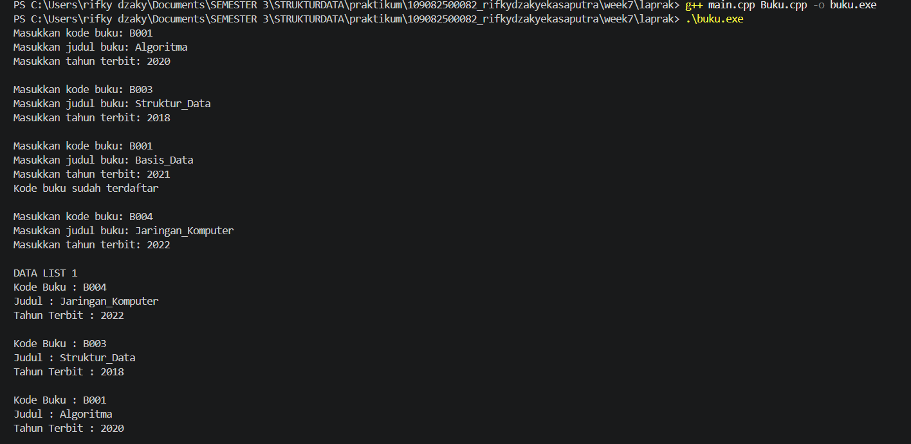
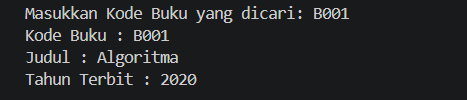
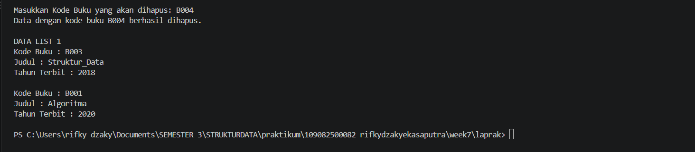

# <h1 align="center">Laporan Praktikum Modul 6 - DOUBLY LINKED LIST (BAGIAN PERTAMA) </h1>
<p align="center">Rifky Dzaky Eka Saputra - 109082500082</p>

## Dasar Teori
Linked list atau yang disebut juga senarai berantai adalah salah satu bentuk struktur data yang berisi kumpulan data yang tersusun secara sekuensial, saling bersambungan, dinamis, dan terbatas[1]. Linked list terdiri dari sejumlah node atau simpul yang dihubungkan secara linier dengan bantuan pointer. Berbeda dengan array, elemen linked list tidak harus ditempatkan pada alamat memori yang berdekatan, melainkan dihubungkan satu sama lain menggunakan pointer [5].


### A. Linked List dan Doubly Linked List<br/>
Linked list memiliki beberapa jenis, salah satunya Doubly Linked List yang menjadi pokok bahasan pada modul ini. Sebelum membahas doubly linked list, perlu dipahami terlebih dahulu karakteristik dasar linked list dan perbedaannya dengan struktur data lain.
#### 1. Karakteristik Linked List
Linked list termasuk struktur data dinamis karena alokasi memorinya dilakukan saat program berjalan. Elemen dapat ditambah atau dihapus tanpa memindahkan elemen lain dan tanpa menentukan ukuran awal seperti pada array [5]. Setiap simpul pada dasarnya berupa struct, sedangkan penghubungnya (link) berupa komponen bertipe pointer yang berada di dalam simpul tersebut [5]. Jika dibandingkan dengan array, array menawarkan akses data yang lebih cepat tetapi kurang fleksibel dalam manajemen memori dinamis, sedangkan linked list lebih fleksibel dengan konsekuensi akses yang lebih lambat [4]. Cara kerja linked list yang cukup rumit juga membuat materi ini sering menjadi kesulitan tersendiri bagi mahasiswa yang mempelajarinya [6].
#### 2. Pengertian Doubly Linked List
Doubly Linked List (DLL) adalah struktur data linier yang terdiri dari node-node yang saling berhubungan, di mana setiap node memiliki dua pointer, yaitu pointer yang menunjuk ke node sebelumnya dan pointer yang menunjuk ke node berikutnya [3]. Dengan demikian, setiap node terdiri dari tiga bagian: data (info), pointer next, dan pointer prev. Pada node pertama, pointer prev bernilai NULL, dan pada node terakhir, pointer next bernilai NULL. Sebuah list umumnya dikelola dengan dua penanda, yaitu First untuk node awal dan Last untuk node akhir, sehingga list dapat ditelusuri dari depan maupun dari belakang.
#### 3. Perbandingan dengan Single Linked List
Single Linked List (SLL) hanya memiliki satu pointer yang menunjuk ke node berikutnya, sedangkan DLL memiliki dua pointer. Keunggulan DLL dibandingkan SLL terletak pada kemudahan operasi penyisipan dan penghapusan data karena DLL memungkinkan navigasi dua arah di dalam list [3]. Sebagai konsekuensinya, setiap node DLL membutuhkan memori tambahan untuk menyimpan pointer prev, dan setiap perubahan pada list harus memperbarui lebih banyak pointer agar kedua arah tautan tetap konsisten.

### B. Abstract Data Type (ADT) dan Operasi pada Doubly Linked List<br/>
Pada praktikum ini, doubly linked list diimplementasikan dalam bentuk ADT beserta operasi-operasi dasarnya, yaitu penyisipan, pencarian, penelusuran, dan penghapusan.
#### 1. Abstract Data Type
Struktur data hanya memperlihatkan bagaimana data diorganisasi, sedangkan ADT memiliki cakupan yang lebih luas karena mengemas struktur data tertentu beserta operasi-operasi yang dapat dilakukan terhadap struktur data tersebut [1]. Pada praktikum ini, ADT Doubly Linked List dipisahkan menjadi file header (.h) yang memuat definisi tipe (infotype, ElmList, List) beserta prototipe fungsi, dan file implementasi (.cpp) yang memuat isi fungsi-fungsinya, sehingga program utama (main.cpp) cukup memanggil operasi yang sudah tersedia.
#### 2. Operasi Penyisipan, Pencarian, dan Penelusuran
Algoritma penyisipan (insertion) pada DLL dapat dilakukan di awal list, di akhir list, atau di tengah list [3]. Pada praktikum ini digunakan insertLast, yaitu menyisipkan elemen baru di akhir list dengan menghubungkan prev elemen baru ke Last yang lama, lalu memperbarui next dari Last lama dan memindahkan penanda Last. Pencarian (findElm) dilakukan secara linier, yaitu menelusuri elemen satu per satu dari First sampai data yang dicari ditemukan atau list habis. Karena adanya pointer prev, penelusuran juga dapat dilakukan mundur dari Last ke First, seperti pada fungsi printInfo. Pencarian ini juga dipakai untuk memeriksa duplikasi data (misalnya nomor polisi atau kode buku) sebelum elemen baru disisipkan.
#### 3. Operasi Penghapusan
Algoritma penghapusan (deletion) pada DLL juga dapat dilakukan di awal list, di akhir list, atau di tengah list [3]. Pada praktikum ini terdapat deleteFirst, deleteLast, dan deleteAfter. Pada setiap penghapusan, pointer next dan prev dari elemen di sekitarnya harus diperbarui agar list tetap tersambung dengan benar, dan kasus khusus seperti list yang hanya berisi satu elemen harus ditangani dengan mengosongkan First dan Last. Setelah elemen dilepas dari list, memorinya dibebaskan melalui dealokasi.

### C. Penerapan<br/>
Struktur data linked list dapat dipakai untuk mengelola data yang sering berubah, misalnya penambahan, pencarian, dan penghapusan data mahasiswa pada aplikasi pengelolaan data, di mana penggunaannya terbukti membuat pengelolaan data lebih fleksibel dan efisien [5]. Linked list, termasuk single dan double linked list, juga dijadikan materi pokok dalam pembelajaran struktur data, khususnya operasi penyisipan dan penghapusan node [6].

## Guided 

### 1. Doublylist.h

```C++
#ifndef DOUBLYLIST_H
#define DOUBLYLIST_H

#include <iostream>
#include <string>

#define Nil NULL

// Latihan 1
struct infotype
{
    std::string nopol;
    std::string warna;
    int thnBuat;
};
typedef struct elmlist *address;
struct elmlist
{
    infotype info;
    address next;
    address prev;
};
struct List
{
    address First;
    address Last;
};

// Latihan 1
void CreateList(List &L);
address alokasi(infotype x);
void dealokasi(address &P);
void printInfo(List L);
void insertLast(List &L, address P);

// Latihan 2

address findElm(List L, std::string nopol);

// Latihan 3
void deleteFirst(List &L, address &P);
void deleteLast(List &L, address &P);
void deleteAfter(List &L, address Prec, address &P);
void deleteElm(List &L, std::string nopol, bool &status);

#endif
```
Pada kode DoublyList.h ini, dibuat struktur data Doubly Linked List untuk menyimpan informasi kendaraan berupa nomor polisi, warna, dan tahun pembuatan. Setiap elemen memiliki pointer next dan prev yang berfungsi menghubungkan data ke elemen berikutnya dan sebelumnya. Selain itu, terdapat struktur List yang memiliki First dan Last sebagai penanda awal dan akhir data. Kode ini juga mendeklarasikan beberapa fungsi untuk membuat list, menambahkan data, menampilkan data, mencari kendaraan berdasarkan nomor polisi, serta menghapus elemen dari list. Jadi, program ini digunakan untuk mengelola data kendaraan dengan sistem linked list yang dapat ditelusuri dari dua arah.

### 2. Doublylist.cpp

```C++
#include "Doublylist.h"

// Latihan 1
void CreateList(List &L) {
    L.First = Nil;
    L.Last = Nil;
}

address alokasi(infotype x) {
    address P = new elmlist;
    P->info = x;
    P->next = Nil;
    P->prev = Nil; 
    return P;
}

void dealokasi(address &P) {
    delete P;
}

void printInfo(List L) {
    address P = L.Last;
    if (P == Nil) {
        std::cout << "List kosong." << std::endl;
        return;
    }
    while (P != Nil) {
        std::cout << "no polisi : " << P->info.nopol << std::endl;   
        std::cout << "warna     : " << P->info.warna << std::endl;   
        std::cout << "tahun     : " << P->info.thnBuat << std::endl; 
        P = P->prev;
    }
}

void insertLast(List &L, address P) {
    if (L.First == Nil) { 
        L.First = P;
        L.Last = P;
    } else {
        P->prev = L.Last;         
        (L.Last)->next = P;     
        L.Last = P;               
    }
}

// Latihan 2
address findElm(List L, std::string nopol) {
    address P = L.First;
    while (P != Nil) {
        if (P->info.nopol == nopol) {
            return P;
        }
        P = P->next;
    }
    return Nil;
}

// Latihan 3
void deleteFirst(List &L, address &P) {
    if (L.First == Nil) return;

    P = L.First; 
    if (L.First == L.Last) { 
        L.First = Nil;
        L.Last = Nil;
    } else {
        L.First = P->next;     
        (L.First)->prev = Nil; 
        P->next = Nil;         
    }
}

void deleteLast(List &L, address &P) {
    if (L.First == Nil) return;

    P = L.Last; 
    if (L.First == L.Last) { 
        L.First = Nil;
        L.Last = Nil;
    } else {
        L.Last = P->prev;      
        (L.Last)->next = Nil; 
        P->prev = Nil;         
    }
}

void deleteAfter(List &L, address Prec, address &P) {
    if (Prec == Nil || Prec->next == Nil) return;

    P = Prec->next;
    if (P == L.Last) {
        deleteLast(L, P);
    } else {
        Prec->next = P->next;     
        (P->next)->prev = Prec; 
        P->next = Nil;            
        P->prev = Nil;           
    }
}

void deleteElm(List &L, std::string nopol, bool &status) {
    address P = findElm(L, nopol);
    status = false;

    if (P != Nil) {
        if (P == L.First) {
            deleteFirst(L, P);
        } else if (P == L.Last) {
            deleteLast(L, P);
        } else {
            address Prec = P->prev;
            deleteAfter(L, Prec, P);
        }
        dealokasi(P); 
        status = true;
    }
}
```
Pada kode Doublylist.cpp ini, dilakukan implementasi fungsi-fungsi Doubly Linked List untuk mengelola data kendaraan. Fungsi CreateList() digunakan untuk membuat list kosong, alokasi() untuk membuat elemen baru, dan insertLast() untuk menambahkan data kendaraan di bagian akhir list. Selanjutnya, printInfo() berfungsi menampilkan data kendaraan dari belakang ke depan, sedangkan findElm() digunakan untuk mencari kendaraan berdasarkan nomor polisi. Pada bagian penghapusan, terdapat fungsi deleteFirst(), deleteLast(), dan deleteAfter() untuk menghapus data sesuai posisi elemen. Terakhir, deleteElm() menggabungkan proses pencarian dan penghapusan kendaraan berdasarkan nomor polisi, sehingga pengelolaan data kendaraan dapat dilakukan dengan lebih mudah.

### 3. main.cpp

```C++
#include <iostream>
#include "Doublylist.h"
using namespace std;

void inputData(List &L) {
    infotype data;
    address P;

    cout << "masukkan nomor polisi: "; cin >> data.nopol;
    cout << "masukkan warna kendaraan: "; cin >> data.warna;
    cout << "masukkan tahun kendaraan: "; cin >> data.thnBuat;
    if (findElm(L, data.nopol) == Nil) {
        P = alokasi(data); 
        insertLast(L, P);  
    } else {
        cout << "nomor polisi sudah terdaftar" << endl; 
    }
}

int main() {
    List L;
    CreateList(L); 
    address P;

    // Latihan 1
    inputData(L); 
    inputData(L); 
    inputData(L); 
    inputData(L); 

    cout << "\nDATA LIST 1" << endl; 
    printInfo(L); 

    // Latihan 2
    string nopolCari;
    cout << "\nMasukkan Nomor Polisi yang dicari : "; 
    cin >> nopolCari; 
    
    P = findElm(L, nopolCari); 
    if (P != Nil) {
        cout << "Nomor Polisi : " << P->info.nopol << endl; 
        cout << "Warna        : " << P->info.warna << endl; 
        cout << "Tahun        : " << P->info.thnBuat << endl; 
    } else {
        cout << "Data dengan nomor polisi " << nopolCari << " tidak ditemukan." << endl;
    }

    // Latihan 3
    string nopolHapus;
    bool hapusBerhasil;
    cout << "\nMasukkan Nomor Polisi yang akan dihapus : ";
    cin >> nopolHapus;

    deleteElm(L, nopolHapus, hapusBerhasil); 

    if (hapusBerhasil) {
        cout << "Data dengan nomor polisi " << nopolHapus << " berhasil dihapus." << endl; 
    } else {
        cout << "Data dengan nomor polisi " << nopolHapus << " tidak ditemukan." << endl;
    }
    cout << "\nDATA LIST 1" << endl; 
    printInfo(L); 

    return 0;
}
```
Pada kode main.cpp ini, program digunakan untuk menjalankan dan menguji fungsi Doubly Linked List dalam pengelolaan data kendaraan. Fungsi inputData() digunakan untuk memasukkan nomor polisi, warna, dan tahun kendaraan sekaligus mengecek agar tidak ada nomor polisi yang sama. Setelah itu, program menampilkan seluruh data kendaraan menggunakan printInfo(), kemudian melakukan pencarian kendaraan berdasarkan nomor polisi dengan findElm(). Pada bagian terakhir, pengguna dapat menghapus data kendaraan berdasarkan nomor polisi menggunakan deleteElm() dan program akan menampilkan pesan apakah data berhasil dihapus atau tidak. Dengan program ini, proses penambahan, pencarian, dan penghapusan data kendaraan dapat diuji secara langsung.

## Unguided 

### 1. ( Pembuatan ADT Dasar dan Insert Data Buatlah implementasi ADT Doubly Linked List pada file “Buku.cpp" dan cobalah hasil implementasi ADT tersebut pada file "main.cpp". Pastikan sistem melakukan pengecekan duplikasi kodeBuku sebelum memasukkan data baru ke dalam list. )

### buku.h
```C++

#ifndef BUKU_H
#define BUKU_H

#include <iostream>
#include <string>
using namespace std;

struct buku {
    string kodeBuku;
    string judul;
    int thnTerbit;
};

typedef buku infotype;

typedef struct ElmList *address;

struct ElmList {
    infotype info;
    address next;
    address prev;
};

struct List {
    address First;
    address Last;
};

void CreateList(List &L);
address alokasi(infotype x);
void dealokasi(address &P);
void printInfo(List L);
void insertLast(List &L, address P);

address findElm(List L, infotype x);

void deleteFirst(List &L, address &P);
void deleteLast(List &L, address &P);
void deleteAfter(address Prec, address &P);

#endif
```
### buku.cpp
```C++

#include "Buku.h"

void CreateList(List &L) {
    L.First = NULL;
    L.Last = NULL;
}

address alokasi(infotype x) {
    address P = new ElmList;
    P->info = x;
    P->next = NULL;
    P->prev = NULL;
    return P;
}

void dealokasi(address &P) {
    delete P;
    P = NULL;
}

void insertLast(List &L, address P) {
    if (L.First == NULL) {
        L.First = P;
        L.Last = P;
    } else {
        P->prev = L.Last;
        L.Last->next = P;
        L.Last = P;
    }
}

void printInfo(List L) {
    address P = L.Last;

    while (P != NULL) {
        cout << "Kode Buku : " << P->info.kodeBuku << endl;
        cout << "Judul : " << P->info.judul << endl;
        cout << "Tahun Terbit : " << P->info.thnTerbit << endl;
        cout << endl;

        P = P->prev;
    }
}

address findElm(List L, infotype x) {
    address P = L.First;

    while (P != NULL) {
        if (P->info.kodeBuku == x.kodeBuku) {
            return P;
        }
        P = P->next;
    }

    return NULL;
}

void deleteFirst(List &L, address &P) {
    P = L.First;

    if (P != NULL) {
        L.First = P->next;

        if (L.First != NULL)
            L.First->prev = NULL;
        else
            L.Last = NULL;

        P->next = NULL;
    }
}

void deleteLast(List &L, address &P) {
    P = L.Last;

    if (P != NULL) {
        L.Last = P->prev;

        if (L.Last != NULL)
            L.Last->next = NULL;
        else
            L.First = NULL;

        P->prev = NULL;
    }
}

void deleteAfter(address Prec, address &P) {
    if (Prec != NULL && Prec->next != NULL) {
        P = Prec->next;
        Prec->next = P->next;

        if (P->next != NULL)
            P->next->prev = Prec;

        P->next = NULL;
        P->prev = NULL;
    } else {
        P = NULL;
    }
}

```
### main cpp
```c++
#include "Buku.h"

int main() {
    List L;
    infotype x;
    address P, cari, hapus;

    CreateList(L);

    // INSERT DATA
    for (int i = 1; i <= 4; i++) {
        cout << "Masukkan kode buku: ";
        cin >> x.kodeBuku;

        cout << "Masukkan judul buku: ";
        cin.ignore();
        getline(cin, x.judul);

        cout << "Masukkan tahun terbit: ";
        cin >> x.thnTerbit;

        if (findElm(L, x) != NULL) {
            cout << "Kode buku sudah terdaftar" << endl;
        } else {
            P = alokasi(x);
            insertLast(L, P);
        }

        cout << endl;
    }

    cout << "DATA LIST 1" << endl;
    printInfo(L);

    // SEARCHING
    cout << "Masukkan Kode Buku yang dicari: ";
    cin >> x.kodeBuku;

    cari = findElm(L, x);

    if (cari != NULL) {
        cout << "Kode Buku : " << cari->info.kodeBuku << endl;
        cout << "Judul : " << cari->info.judul << endl;
        cout << "Tahun Terbit : " << cari->info.thnTerbit << endl;
    } else {
        cout << "Data buku tidak ditemukan" << endl;
    }

    cout << endl;

    // DELETE DATA
    cout << "Masukkan Kode Buku yang akan dihapus: ";
    cin >> x.kodeBuku;

    cari = findElm(L, x);

    if (cari != NULL) {
        if (cari == L.First) {
            deleteFirst(L, hapus);
        } else if (cari == L.Last) {
            deleteLast(L, hapus);
        } else {
            deleteAfter(cari->prev, hapus);
        }

        dealokasi(hapus);
        cout << "Data dengan kode buku "
             << x.kodeBuku << " berhasil dihapus." << endl;
    } else {
        cout << "Data buku tidak ditemukan." << endl;
    }

    cout << endl;
    cout << "DATA LIST 1" << endl;
    printInfo(L);

    return 0;
}

```
### Output Unguided 1 :

##### Output 1


##### Output Pencarian


##### Output Penghapusan elemen 


Pada Unguided 1, program ini dibuat menggunakan bahasa C++ dengan menerapkan konsep Abstract Data Type (ADT) dan Doubly Linked List untuk mengelola data buku yang terdiri dari kode buku, judul, dan tahun terbit. Pada file `Buku.h`, dibuat struktur data yang berfungsi sebagai dasar program, yaitu `infotype` untuk menyimpan informasi buku, `ElmList` sebagai elemen atau node yang memiliki pointer `next` dan `prev`, serta `List` yang memiliki penanda awal (`First`) dan akhir (`Last`). Selanjutnya, pada file `Buku.cpp`, dibuat implementasi beberapa fungsi, seperti `CreateList()` untuk menginisialisasi list kosong, `alokasi()` untuk membuat node baru, `dealokasi()` untuk membebaskan memori, `insertLast()` untuk menambahkan data di akhir list, dan `printInfo()` untuk menampilkan seluruh data buku dari belakang ke depan. Selain itu, terdapat fungsi `findElm()` yang digunakan untuk mencari buku berdasarkan kode buku, serta fungsi `deleteFirst()`, `deleteLast()`, dan `deleteAfter()` untuk menghapus elemen berdasarkan posisinya. Pada file `main.cpp`, seluruh fungsi tersebut dijalankan dengan meminta pengguna memasukkan empat data buku. Sebelum data disimpan, program terlebih dahulu memeriksa apakah kode buku sudah pernah terdaftar agar tidak terjadi duplikasi. Setelah proses input selesai, data ditampilkan, kemudian pengguna dapat mencari buku berdasarkan kode tertentu dan menghapus buku yang diinginkan. Jika data berhasil ditemukan dan dihapus, program akan menampilkan pesan bahwa penghapusan berhasil, kemudian menampilkan kembali data yang masih tersimpan. Melalui program ini, dapat dipahami bagaimana konsep Doubly Linked List bekerja dalam proses penambahan, pencarian, penampilan, dan penghapusan data buku secara terstruktur.

## Kesimpulan
Berdasarkan praktikum Modul 6 ini, dapat disimpulkan bahwa Doubly Linked List adalah struktur data dinamis yang setiap node-nya memiliki dua pointer, yaitu `next` dan `prev`, sehingga data dapat ditelusuri dari dua arah, baik dari `First` ke `Last` maupun sebaliknya. Pada bagian Guided, konsep ini diterapkan untuk mengelola data kendaraan (nomor polisi, warna, dan tahun pembuatan) melalui ADT yang dipisahkan menjadi `Doublylist.h`, `Doublylist.cpp`, dan `main.cpp`. Pemisahan ini membuat struktur data dan operasinya tersusun rapi dan mudah dipakai ulang.

Pada bagian Unguided, konsep yang sama diterapkan pada data buku (kode buku, judul, dan tahun terbit). Program memeriksa duplikasi kode buku dengan `findElm()` sebelum data disisipkan dengan `insertLast()`. Dari praktikum ini juga dipahami bahwa setiap operasi penghapusan (`deleteFirst`, `deleteLast`, dan `deleteAfter`) harus memperbarui pointer `next` dan `prev` elemen di sekitarnya. Kasus khusus, seperti list yang hanya berisi satu elemen, harus ditangani dengan mengosongkan `First` dan `Last` agar list tetap konsisten. Selain itu, memori elemen yang sudah dilepas dari list perlu dibebaskan dengan `dealokasi()` agar tidak terjadi kebocoran memori.

Secara keseluruhan, praktikum ini menunjukkan bahwa doubly linked list cocok digunakan untuk data yang sering berubah dan membutuhkan penelusuran dua arah. Kelebihan ini diimbangi dengan kebutuhan memori tambahan untuk pointer `prev` dan pengaturan pointer yang lebih teliti dibandingkan single linked list.

## Referensi
<br>[3] Wijoyo, A., Prayudi, L. A., Fiqih, M., Santoso, R. D., Putra, R. T. S., Arifin, T., & Farhan, A. (2024). "Penggunaan Algoritma Doubly Linked List Untuk Insertion Dan Deletion". JRIIN: Jurnal Riset Informatika dan Inovasi, 1(12), 1329–1331. Diakses melalui https://jurnalmahasiswa.com/index.php/jriin/article/view/1282.
<br>[4] Fitra, M. R. A., Effendi, A. A. S., & Ramadhani, F. (2025). "Implementasi Python dalam Pengolahan Data Pribadi Mahasiswa Ilmu Komputer Angkatan 23 pada Universitas Negeri Medan Menggunakan Struktur Data Linked List". JATI (Jurnal Mahasiswa Teknik Informatika), 9(1), 51–58. Diakses melalui https://www.ejournal.itn.ac.id/jati/article/download/12164/6831.
