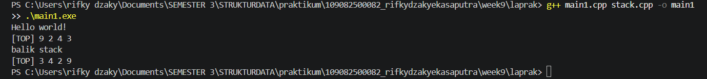
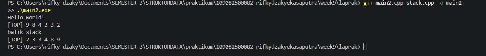
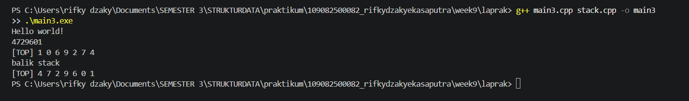

# <h1 align="center">Laporan Praktikum Modul 7 - STACK </h1>
<p align="center">Rifky Dzaky Eka Saputra - 109082500082</p>

## Dasar Teori
Stack atau tumpukan adalah struktur data linear yang proses penambahan dan penghapusan elemennya hanya dilakukan pada satu ujung, yaitu bagian atas (top). Karena itu, elemen yang terakhir dimasukkan akan menjadi elemen pertama yang dikeluarkan, atau yang dikenal dengan prinsip LIFO (Last In First Out) [1]. Pada praktikum ini, stack direpresentasikan menggunakan array dan dipisahkan menjadi tiga bagian, yaitu file header (`stack.h`), file implementasi (`stack.cpp`), dan program utama (`main.cpp`).

### A. Konsep Dasar Stack<br/>
Stack bekerja seperti tumpukan benda dalam kehidupan sehari-hari.
#### 1. Pengertian dan Prinsip LIFO
Stack merupakan struktur data linear yang hanya mengizinkan perubahan data pada ujung tumpukan. Contohnya seperti tumpukan baju di lemari: baju yang paling atas adalah yang terakhir ditaruh dan yang pertama diambil [1]. Hal ini sejalan dengan pendapat bahwa stack digunakan pada kasus yang membutuhkan pemrosesan data mulai dari data yang paling terakhir masuk [2].
#### 2. Operasi Dasar Stack
Operasi utama pada stack meliputi push untuk menambahkan elemen ke posisi teratas, pop untuk menghapus elemen teratas sekaligus mengembalikan nilainya, peek atau top untuk melihat elemen teratas tanpa menghapusnya, isEmpty untuk memeriksa apakah stack kosong, dan size untuk mengetahui jumlah elemen di dalam stack [1]. Pada praktikum ini, operasi tersebut diwujudkan dalam prosedur `CreateStack`, `push`, `pop`, `printInfo`, dan `balikStack`, serta ditambah `pushAscending` dan `getInputStream`.
#### 3. Penerapan Stack
Stack banyak dipakai dalam pemrograman, misalnya untuk evaluasi ekspresi matematika, manajemen memori, dan pemrosesan fungsi secara rekursif [1]. Penerapan lain yang umum adalah fitur undo/redo pada program [2].

### B. Implementasi Stack dengan Array<br/>
Stack dapat dibangun dengan dua pendekatan umum, yaitu array dan linked list [1].
#### 1.  Array sebagai Penyimpan Elemen Stack
Array adalah tipe data terstruktur yang dapat menyimpan banyak data bertipe sama dengan satu nama, menempati memori yang berurutan, dan diakses melalui indeks yang dimulai dari 0 [1]. Sifat inilah yang membuat array cocok dipakai sebagai wadah elemen stack.
#### 2. Penunjuk Top
Pada stack berbasis array, variabel `top` dipakai untuk menandai indeks elemen teratas. Saat push, nilai `top` dinaikkan lalu data disimpan pada posisi tersebut. Saat pop, data pada posisi `top` diambil lalu nilai `top` diturunkan, seperti pada contoh implementasi stack array di [1].
#### 3. Kelebihan dan Keterbatasan
Stack berbasis array memiliki akses langsung melalui indeks dengan kompleksitas waktu O(1), implementasinya sederhana, dan tidak memerlukan pointer tambahan sehingga pemakaian memorinya efisien. Namun, ukurannya bersifat tetap karena ditentukan saat deklarasi, sehingga sulit diubah secara dinamis [1]. Karena itu, pendekatan array lebih sesuai untuk kebutuhan dengan ukuran data yang sudah diketahui, sedangkan linked list lebih unggul untuk data yang ukurannya berubah-ubah [1].

## Guided 

### 1. stack.h

```C++
/* file : stack.h
   contoh ADT stack dengan representasi tabel */
#ifndef STACK_H_INCLUDED
#define STACK_H_INCLUDED

#include <iostream>
using namespace std;

struct infotype {
    char nim[20];
    char nama[20];
};
struct Stack {
    infotype info[10];
    int Top;
};

/* prototype */
/******** pengecekan apakah Stack kosong *********/
int isEmpty(Stack S);
/* mengembalikan nilai 0 jika stack kosong */

/******** pembuatan Stack ********/
void createStack(Stack &S);
/* I.S. sembarang
   F.S. terbentuk stack dengan Top=0 */

/******** penambahan elemen pada Stack ********/
void push(Stack &S, infotype X);
/* I.S. Stack mungkin kosong
   F.S. menambahkan elemen pada stack dengan nilai X, TOP=TOP+1 */

/******** penghapusan elemen pada Stack ********/
void pop(Stack &S, infotype &X);
/* I.S. stack tidak kosong
   F.S. nilai info pada indeks TOP disimpan pada X, kemudian TOP=TOP-1 */

/******** proses semua elemen Stack *********/
void viewStack(Stack S);
/* I.S. stack mungkin kosong
   F.S. jika stack tidak kosong menampilkan semua info yang ada pada stack
*/
#endif // STACK_H_INCLUDED

```
Kode ini merupakan file header `stack.h` yang mendefinisikan ADT Stack dengan representasi array untuk menyimpan data mahasiswa. Di dalamnya terdapat include guard untuk menghindari file dimuat berulang kali, struct `infotype` yang menampung NIM dan nama, serta struct `Stack` yang berisi array `info` berkapasitas 10 elemen dan variabel `Top` sebagai penanda posisi elemen teratas. File ini juga memuat prototype lima operasi dasar, yaitu `isEmpty` untuk memeriksa apakah stack kosong, `createStack` untuk membentuk stack baru dengan `Top` bernilai 0, `push` untuk menambahkan elemen ke puncak stack, `pop` untuk mengambil elemen puncak sekaligus menurunkan `Top`, dan `viewStack` untuk menampilkan seluruh isi stack. Seluruh operasi tersebut mengikuti prinsip LIFO (Last In First Out), di mana data yang terakhir dimasukkan akan menjadi yang pertama dikeluarkan, sedangkan isi dari setiap fungsinya baru ditulis pada file `stack.cpp`.

### 2. stack.cpp

```C++
#include "stack.h"

int isEmpty(Stack S) {
    /* Top = 0 berarti kosong, sesuai komentar di stack.h dikembalikan 0 */
    if (S.Top == 0) {
        return 0;
    } else {
        return 1;
    }
}

void createStack(Stack &S) {
    S.Top = 0;
}

void push(Stack &S, infotype X) {
    if (S.Top < 10) {
        S.Top = S.Top + 1;
        S.info[S.Top - 1] = X;   /* Top 1..10 dipetakan ke indeks array 0..9 */
    } else {
        cout << "Stack penuh, data tidak bisa ditambahkan" << endl;
    }
}

void pop(Stack &S, infotype &X) {
    if (isEmpty(S) != 0) {
        X = S.info[S.Top - 1];
        S.Top = S.Top - 1;
    } else {
        cout << "Stack kosong, tidak ada data yang bisa diambil" << endl;
    }
}

void viewStack(Stack S) {
    if (isEmpty(S) == 0) {
        cout << "Stack kosong" << endl;
    } else {
        cout << "Isi stack (dari TOP):" << endl;
        for (int i = S.Top; i >= 1; i--) {
            cout << i << ". " << S.info[i - 1].nim << " - "
                 << S.info[i - 1].nama << endl;
        }
    }
}

```
File stack.cpp ini berisi implementasi dari semua operasi yang dideklarasikan di stack.h, dengan Top yang menunjukkan jumlah elemen dalam stack. Fungsi isEmpty memeriksa Top: jika bernilai 0 (stack kosong) hasilnya 0, selain itu hasilnya 1. Prosedur createStack membuat stack baru dengan mengisi Top dengan 0. Prosedur push menaikkan Top lalu menyimpan data di indeks Top - 1, karena posisi Top 1 sampai 10 dipetakan ke indeks array 0 sampai 9, dan jika stack sudah penuh akan muncul pesan peringatan. Prosedur pop mengambil data di indeks Top - 1 ke parameter X lalu menurunkan Top, atau menampilkan pesan jika stack kosong. Prosedur viewStack menampilkan seluruh isi stack dari elemen paling atas ke bawah lengkap dengan nomor, NIM, dan namanya, atau menuliskan “Stack kosong” jika tidak ada data.

### 3. main.cpp

```C++
#include <iostream>
#include <cstring>
#include "stack.h"
using namespace std;

int main() {
    Stack S;
    infotype data, hasil;

    createStack(S);
    cout << "Stack baru dibuat, Top = " << S.Top << endl;
    viewStack(S);

    cout << endl << "--- Push 3 data ---" << endl;
    strcpy(data.nim, "103112400001");
    strcpy(data.nama, "Andi");
    push(S, data);

    strcpy(data.nim, "103112400002");
    strcpy(data.nama, "Budi");
    push(S, data);

    strcpy(data.nim, "103112400003");
    strcpy(data.nama, "Citra");
    push(S, data);
    viewStack(S);

    cout << endl << "--- Pop 1 data ---" << endl;
    pop(S, hasil);
    cout << "Data yang diambil: " << hasil.nim << " - " << hasil.nama << endl;
    viewStack(S);

    cout << endl << "--- Pop sampai kosong ---" << endl;
    pop(S, hasil);
    pop(S, hasil);
    pop(S, hasil);
    viewStack(S);

    return 0;
}

```
File `main.cpp` ini adalah program utama yang menguji seluruh operasi stack pada `stack.h` dan `stack.cpp`. Program dimulai dengan membuat stack kosong lewat `createStack`, lalu menampilkan nilai `Top` awal (0) beserta isi stack yang masih kosong. Setelah itu, tiga data mahasiswa (Andi, Budi, dan Citra) dimasukkan satu per satu: NIM dan nama disalin ke variabel `data` dengan `strcpy` (karena bertipe array char), kemudian di-push ke stack, dan isinya ditampilkan dengan `viewStack` yang urutannya dari Citra sebagai elemen teratas. Tahap berikutnya adalah `pop` satu kali, sehingga Citra diambil ke variabel `hasil` dan dicetak, lalu isi stack ditampilkan lagi yang kini tinggal Budi dan Andi. Terakhir, `pop` dipanggil tiga kali berturut-turut padahal data tersisa hanya dua, sehingga pemanggilan ketiga memunculkan pesan "Stack kosong, tidak ada data yang bisa diambil", dan `viewStack` terakhir menampilkan "Stack kosong". Pesan tersebut adalah perilaku yang memang disengaja untuk menguji penanganan stack kosong, bukan error.

## Unguided 

### 1. (Buatlah ADT Stack menggunakan ARRAY sebagai berikut di dalam file “stack.h”: Buatlah implementasi ADT Stack menggunakan Array pada file “stack.cpp” dan “main.cpp”)

### stack.h
```C++
#ifndef STACK_H
#define STACK_H

#include <iostream>
using namespace std;

typedef int infotype;

struct Stack {
    infotype info[20];
    int top;            
};

void CreateStack(Stack &S);
void push(Stack &S, infotype x);
infotype pop(Stack &S);
void printInfo(Stack S);
void balikStack(Stack &S);


void pushAscending(Stack &S, infotype x);


void getInputStream(Stack &S);

#endif

```
### stack.cpp
```c++
#include "stack.h"

void CreateStack(Stack &S) {
    S.top = -1;
}

void push(Stack &S, infotype x) {
    if (S.top < 19) {
        S.top++;
        S.info[S.top] = x;
    } else {
        cout << "Stack penuh!" << endl;
    }
}

infotype pop(Stack &S) {
    if (S.top == -1) {
        cout << "Stack kosong!" << endl;
        return -1;
    }
    infotype x = S.info[S.top];
    S.top--;
    return x;
}

void printInfo(Stack S) {
    cout << "[TOP] ";
    for (int i = S.top; i >= 0; i--) {
        cout << S.info[i] << " ";
    }
    cout << endl;
}

void balikStack(Stack &S) {
    int i = 0, j = S.top;
    while (i < j) {
        infotype temp = S.info[i];
        S.info[i] = S.info[j];
        S.info[j] = temp;
        i++;
        j--;
    }
}

void pushAscending(Stack &S, infotype x) {
    Stack temp;
    CreateStack(temp);

    while (S.top != -1 && S.info[S.top] > x) {
        push(temp, pop(S));
    }
    push(S, x);
    while (temp.top != -1) {
        push(S, pop(temp));
    }
}

void getInputStream(Stack &S) {
    char c = cin.get();
    while (c != '\n') {
        if (c >= '0' && c <= '9') {
            push(S, c - '0');
        }
        c = cin.get();
    }
}

```
### main1.cpp
```c++
#include "stack.h"

int main() {
    cout << "Hello world!" << endl;
    Stack S;
    CreateStack(S);
    push(S, 3);
    push(S, 4);
    push(S, 8);
    pop(S);
    push(S, 2);
    push(S, 1);
    pop(S);
    push(S, 9);
    printInfo(S);
    cout << "balik stack" << endl;
    balikStack(S);
    printInfo(S);
    return 0;
}

```
### Output Unguided 1 :

##### Output 1


Unguided 1 membuat ADT Stack berbasis array yang menyimpan bilangan bulat, dibagi menjadi tiga file. File `stack.h` mendefinisikan `infotype` sebagai `int` dan struct `Stack` berisi array `info` berkapasitas 20 elemen serta variabel `top` sebagai penunjuk elemen teratas, lalu memuat prototype operasinya. File `stack.cpp` berisi implementasinya: `CreateStack` mengisi `top` dengan -1 sebagai tanda stack kosong, `push` menaikkan `top` lalu menyimpan nilai baru (dengan pengecekan jika stack penuh), `pop` mengambil nilai di `top` lalu menurunkannya (dengan pengecekan jika kosong), `printInfo` mencetak isi stack dari puncak ke dasar diawali tulisan `[TOP]`, dan `balikStack` membalik urutan isi stack dengan menukar elemen dari kedua ujung array. File `main1.cpp` kemudian menjalankan skenario berikut: push 3, 4, 8, pop (8 keluar), push 2, 1, pop (1 keluar), dan push 9, sehingga isi stack menjadi 3, 4, 2, 9 dari dasar ke puncak dan tercetak `[TOP] 9 2 4 3`. Setelah itu stack dibalik dengan `balikStack` dan tercetak lagi sebagai `[TOP] 3 4 2 9`. Fungsi `pushAscending` dan `getInputStream` pada file tersebut belum dipakai di unguided 1 karena itu untuk soal 2 dan 3.

### 2. (Tambahkan prosedur pushAscending( in/out S : Stack, in x : integer) )

### main2.cpp
```C++
#include "stack.h"

int main() {
    cout << "Hello world!" << endl;
    Stack S;
    CreateStack(S);
    pushAscending(S, 3);
    pushAscending(S, 4);
    pushAscending(S, 8);
    pushAscending(S, 2);
    pushAscending(S, 3);
    pushAscending(S, 9);
    printInfo(S);
    cout << "balik stack" << endl;
    balikStack(S);
    printInfo(S);
    return 0;
}

```
### Output Unguided 2 :

##### Output 1


File `main2.cpp` adalah program utama untuk unguided 2 yang menguji prosedur `pushAscending`, yaitu prosedur yang memasukkan data ke stack sambil menjaga urutannya tetap menaik dari dasar ke puncak. Program diawali dengan mencetak "Hello world!", membuat stack kosong lewat `CreateStack`, lalu memanggil `pushAscending` sebanyak enam kali dengan nilai 3, 4, 8, 2, 3, dan 9. Setiap nilai baru tidak langsung ditaruh di puncak, tetapi disisipkan pada posisi yang sesuai: elemen yang lebih besar dipindahkan sementara ke stack bantu, nilai baru di-push, lalu elemen tadi dikembalikan. Akibatnya, walaupun urutan masukannya acak, isi stack selalu terurut, yaitu 2, 3, 3, 4, 8, 9 dari dasar ke puncak, sehingga `printInfo` mencetak `[TOP] 9 8 4 3 3 2`. Setelah itu program menuliskan "balik stack", memanggil `balikStack` untuk membalik urutan isi stack, dan mencetaknya kembali sebagai `[TOP] 2 3 3 4 8 9`, di mana nilai terkecil berada di puncak.

### 3. (Tambahkan prosedur getInputStream( in/out S : Stack ). Prosedur akan terus membaca dan menerima input user dan memasukkan setiap input ke dalam stack hingga user menekan tombol enter. Contoh: gunakan cin.get() untuk mendapatkan inputan user. )

### main3.cpp
```C++
#include "stack.h"

int main() {
    cout << "Hello world!" << endl;
    Stack S;
    CreateStack(S);
    getInputStream(S);
    printInfo(S);
    cout << "balik stack" << endl;
    balikStack(S);
    printInfo(S);
    return 0;
}
```
### Output Unguided 3 :

##### Output 1


File `main3.cpp` adalah program utama untuk unguided 3 yang menguji prosedur `getInputStream`, yaitu prosedur yang mengisi stack dari input yang diketik pengguna. Program diawali dengan mencetak "Hello world!" dan membuat stack kosong lewat `CreateStack`. Setelah itu `getInputStream` dipanggil, sehingga program berhenti menunggu pengguna mengetik deretan angka, misalnya `4729601`. Di dalam prosedur tersebut, setiap karakter dibaca satu per satu dengan `cin.get()` sampai pengguna menekan ENTER, dan setiap karakter yang berupa digit diubah menjadi angka lalu di-push ke stack. Karena digit yang dimasukkan terakhir berada di puncak, `printInfo` mencetak urutan terbalik dari input, yaitu `[TOP] 1 0 6 9 2 7 4`. Terakhir, program menuliskan "balik stack", memanggil `balikStack` untuk membalik isi stack, dan mencetaknya lagi sebagai `[TOP] 4 7 2 9 6 0 1`, yang urutannya kembali sama seperti angka yang diketik pengguna.

## Kesimpulan
Berdasarkan seluruh praktikum ini, dapat disimpulkan bahwa Stack adalah struktur data linear yang bekerja dengan prinsip LIFO (Last In First Out), sehingga data yang terakhir dimasukkan menjadi data yang pertama dikeluarkan. Stack dapat direpresentasikan menggunakan array dengan bantuan variabel `top` sebagai penunjuk elemen teratas, dan seluruh operasinya, yaitu `CreateStack`, `push`, `pop`, `printInfo`, dan `balikStack`, mengacu pada penunjuk tersebut. Pada unguided 1, operasi dasar stack berhasil diterapkan untuk menyimpan, mengambil, menampilkan, dan membalik isi stack. Pada unguided 2, prosedur `pushAscending` membuktikan bahwa stack tetap dapat menjaga data terurut menaik dengan bantuan stack sementara, meskipun hanya bisa diakses dari satu sisi. Pada unguided 3, prosedur `getInputStream` menunjukkan bahwa stack dapat diisi secara dinamis dari input pengguna, dan hasilnya membuktikan sifat LIFO karena urutan data tercetak berkebalikan dengan urutan pengetikan, yang kemudian dapat dikembalikan dengan `balikStack`. Selain itu, praktikum ini menegaskan pentingnya pemisahan program ke dalam file header (`stack.h`), implementasi (`stack.cpp`), dan program utama (`main.cpp`), serta kewajiban mengompilasi semua file `.cpp` secara bersamaan agar tidak muncul error `undefined reference` saat proses linking.

## Referensi
[1] Setiyawan, R. D., Hermawan, D., Abdillah, A. F., Mujayanah, A., & Vindua, R. (2024). Penggunaan Struktur Data Stack dalam Pemrograman C++ dengan Pendekatan Array dan Linked List. JUTECH, 5(2), 484–498. Diakses melalui https://jurnal.stkippersada.ac.id/jurnal/index.php/jutech/article/download/4263/pdf
<br>[2] Selamet, R. (2016). Implementasi Struktur Data List, Queue dan Stack dalam Java. Media Informatika, 15(3). Diakses melalui https://jurnal.likmi.ac.id/Jurnal/11_2016/112016_03_Rachmat.pdf
